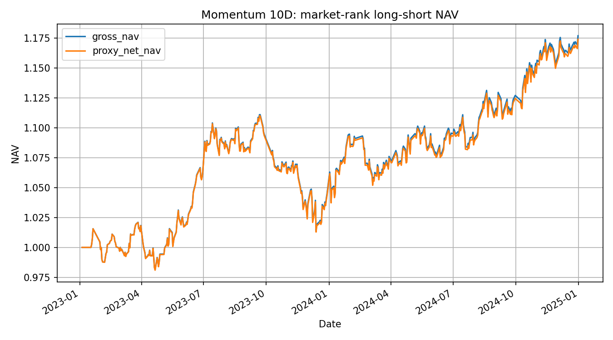

# Early Bird Alpha

面向中国期货市场的多因子策略量化研究框架，覆盖数据引擎、因子评价、组合实验与回测。

## 项目背景

### 为什么写这个项目？

*本人2025年毕业，2026年3月起转型学习量化，边写基础设施边做研究。*

### 为什么不用聚宽、米筐等已有平台，自己造轮子？

*理查德·费曼说过，"What I cannot create, I do not understand. Know how to solve every problem that has been solved." 我认为应该是这样。成熟平台隐藏了大量对研究很重要的细节，严肃的学习者至少应该尝试去理解它们。*

### 代码是自己写的，还是 AI 写的？

*绝大多数核心功能，包括数据引擎+因子模块，均由自己完成，或至少完成初稿。工作流为AI教学，个人落地，AI复核。学习研究框架+磨炼coding技能。保证研究全产业链持续自主可控（笑）。*

### 目前是否在求职？

*是的，偏好上海地区量化行业，不限资产类型，若您可提供工作机会，欢迎联系我😊。邮箱：jesse_gan@foxmail.com。*


## 快速开始

### 1. 克隆项目

```powershell
git clone --depth 1 https://github.com/JesseGXQ/early-bird-alpha.git
cd early-bird-alpha
```

后续命令请从仓库根目录执行。

`--depth 1` 只拉取最新一次提交，跳过历史，更快且占用更小；若需完整提交历史（查看变更、切回旧版本、`git blame` 等），再执行：

```powershell
git fetch --unshallow
```

### 2. 创建 Conda 环境

项目用 Python 3.12，依赖见 `environment.yml`：

```powershell
conda env create -f environment.yml
conda activate early-bird-alpha
```

若已创建过该环境，请按最新依赖更新：

```powershell
conda env update -n early-bird-alpha -f environment.yml --prune
```

### 3. 运行 Quickstart

Quickstart 用一份截取出的小型真实日频样本，完成因子计算 -> 组合实验的研究闭环：

```powershell
python examples/factor_quickstart.py
```

依次完成：

```text
读取 ResearchDataset 样本
→ 计算 10 日动量因子
→ 构造未来 5 日收益标签
→ 计算覆盖率、IC、Rank IC
→ 运行 market_rank_ls 诊断组合实验
→ 输出 Sharpe、CAGR、总收益并保存净值曲线
```

当前版本预期输出：

```text
Factor Quickstart
-----------------
Products: CU, AO, MA, LC, JD, EG, RM, B, PK, TF
Sample period: 2023-01-03 ~ 2024-12-31
Observations: 4598
Factor: momentum_10
Factor coverage: 100.00%
Joint coverage: 98.85%
Cross-Sectional Mean IC (5D forward-return label): 0.0193
Cross-Sectional Mean Rank IC (5D forward-return label): 0.0052
Portfolio: market_rank_ls, rebalance=5D, cost=3bp
Total return: 17.38%
CAGR: 8.72%
Sharpe: 1.022
NAV chart: <仓库路径>\examples\artifacts\factor_quickstart_nav.png
```

NAV chart：



## 研究组件清单（20261107版本）

现有研究能力集中在两层：
- `data`： 数据引擎，负责原始行情 -> 结构化的数据面板，
- `factors`：因子模块。负责数据面板->构造、计算因子、预处理、合成信号，因子评价和组合实验。目前支持日频为主。

```text
取数    DataFacade：ResearchFeed / TermStructureFeed / FundamentalFeed / SimulationFeed
构建    ResearchDatasetBuilder → ResearchDataset（含数据质量摘要）
选池    DynamicUniverse：逐时点品种准入，保留排除原因
因子    Factor.compute → FactorPreprocessor/PreprocessingPipeline
标签    LabelBuilder
评价    evaluation/*：覆盖率、IC / Rank IC、分组收益、回归、方向命中率
组合    combination（因子合成）→ DiagnosticPortfolio（研究权重、成本、净值、归因）
```

- `SimulationFeed` 走逐笔事件流，供仿真回测，不进入因子研究链路。

### `data`：数据引擎

统一入口 `DataFacade`，向下管存储、规则、日历、拼接与清洗，向上只暴露研究面板、事件流、期限结构、基本面四类数据。

<details>
<summary><b>展开</b></summary>

#### 统一入口

| 组件 | 职责 | 入口 |
| --- | --- | --- |
| `DataFacade` | 按配置组装组件，提供向量、快照流、期限结构、仓单等取数方法。 | `data/facade.py` |
| `RuleQueryService` | 交易规则的只读查询接口，供研究侧查品种、合约与板块。 | `data/query_service.py` |
| `factory` / `config` | 组件装配工厂；换月、复权、抽样、路径等全部配置。 | `data/factory.py`、`data/config.py` |

#### feed 数据馈送

| 组件 | 职责 | 入口 |
| --- | --- | --- |
| `ResearchFeed` | 输出单品种后复权主力连续合约，是向量化研究的主数据源。 | `data/feed/research_feed.py` |
| `SimulationFeed` | 以逐笔快照与事件流回放行情，供事件驱动仿真（待开发）。 | `data/feed/simulation_feed.py` |
| `TermStructureFeed` | 输出全合约日频长表（主力标识、剩余到期日），支撑期限结构因子。 | `data/feed/term_structure_feed.py` |
| `FundamentalFeed` | 提供仓单日报明细与品种日聚合，可扩展库存、现货等。 | `data/feed/fundamental_feed.py` |
| `BarAggregator` | 按绝对累计交易分钟索引把 1min K 线降到低频，并处理夜盘跨日。 | `data/feed/aggregator.py` |

#### storage 存储与加载

| 组件 | 职责 | 入口 |
| --- | --- | --- |
| `FileLocator` | 按品种、合约、日期定位本地数据文件。 | `data/storage/file_locator.py` |
| `BarLoader` | 读取 1min K 线并做 LRU 缓存。 | `data/storage/bar_loader.py` |
| `DailySnapshotManager` | 管理日频快照，提供单合约某日快照与涨跌停价。 | `data/storage/daily_snapshot_manager.py` |
| `TickLoaderFactory` | 逐块读取 TICK 文件，避免一次性载入内存。 | `data/storage/tick_loader.py` |
| `WarehouseReceiptLoader` | 读取仓单日报原始文件。 | `data/storage/warehouse_receipt_loader.py` |

#### stitching 主力连续合约

| 组件 | 职责 | 入口 |
| --- | --- | --- |
| `RolloverDetector` | 按持仓量硬/软规则生成换月日历。 | `data/stitching/stitching.py` |
| `RollGapCalculator` | 计算换月跳空价差，生成换月总表。 | `data/stitching/stitching.py` |
| `ContinuousContractManager` | 按换月表拼接主力连续合约，给出任意日期的活跃合约。 | `data/stitching/stitching.py` |

#### rules 交易规则库

| 组件 | 职责 | 入口 |
| --- | --- | --- |
| `ProductMetaManager` | 品种元数据：交易所、合约乘数、报价单位、交易时段。 | `data/rules/product_meta_manager.py` |
| `InstrumentRegistryManager` | 合约注册信息：上市日、到期日、交割月。 | `data/rules/instrument_registry_manager.py` |
| `InstrumentDailyStatusManager` | 合约日频状态：是否主力、保证金率、涨跌停价。 | `data/rules/instrument_daily_status_manager.py` |
| `ExchangeHolidayManager` | 交易所节假日。 | `data/rules/exchange_holiday_manager.py` |
| `ProductClassificationManager` | 品种板块分类。 | `data/rules/product_classification_manager.py` |
| `TradingRuleService` | 规则库统一门面，含交易时段解释（`SessionRuleResolver`）。 | `data/rules/trading_rule_service.py` |

#### calendar 交易日历

| 组件 | 职责 | 入口 |
| --- | --- | --- |
| `ExchangeCalendarManager` | 交易所交易日历的查询。 | `data/calendar/exchange_calendar_manager.py` |
| `ProductCalendar` | 品种级日历：交易日判定、时段归属、时间戳与偏移换算。 | `data/calendar/product_calendar.py` |

#### cleaning 数据清洗

| 组件 | 职责 | 入口 |
| --- | --- | --- |
| `CleaningPipeline` | 串接一组 Filter 依次加工原始 TICK / 1min 数据。 | `data/cleaning/cleaning_tick.py` |
| Filter 组 | 代码标准化、涨跌停价补全、日历时间戳生成、异常值剔除、涨跌停过滤、schema 校验。 | `data/cleaning/cleaning_tick.py` |
| `DelayedNightOpenFixer` | 修复 2019-12-26 夜盘延迟开市造成的竞价 K 线错位。 | `data/cleaning/cleaning_bar_1min.py` |

</details>

### `factors`：因子研究

从数据集到研究证据的完整链路：数据 → 因子 → 预处理 → 标签 → 评价 →（可选）合成与组合实验。

<details>
<summary><b>展开</b></summary>

#### 数据集与领域模型

| 组件 | 职责 | 入口 |
| --- | --- | --- |
| `ResearchDatasetBuilder` | 经 `DataFacade` 取数、校验 schema，产出统一研究面板。 | `factors/dataset.py` |
| `models` | 领域对象：`DatasetSpec`、`FactorResult`、`LabelSpec`、`HarvestProfile`、`CandidateFactor` 等。 | `factors/models.py` |
| `DynamicUniverse` | 按上市天数、流动性等条件逐时点生成品种池，并保留排除原因。 | `factors/universe.py` |
| `FactorDataBridge` | 按因子声明的 `DataRequirement` 补取引擎未暴露的数据，避免逐个改数据集构建器。 | `factors/bridge.py` |
| `presets` | 一键开局：默认品种池、数据集构建与 `DataFacade` 构造。 | `factors/presets.py` |

#### library 因子库

| 组件 | 职责 | 入口 |
| --- | --- | --- |
| `Factor` | 因子抽象基类，约定 `name`、`data_requirements`、`compute`，并提供可选增量接口。 | `factors/library/base.py` |
| `basic` | 基础因子：`MomentumFactor`、`RollYieldFactor`、`CurveSlope`。 | `factors/library/basic.py` |
| `future_native` | 期货原生机制因子，按机制分文件：期限结构、持仓、交割、结算、涨跌停、保证金、交易时段。 | `factors/library/others/future_native/` |

#### preprocess 预处理

| 组件 | 职责 | 入口 |
| --- | --- | --- |
| 缺失值 | 时序与截面两种口径的填充或剔除。 | `factors/preprocess/clean.py` |
| 缩尾 | 滚动时序与截面分位数缩尾。 | `factors/preprocess/winsorize.py` |
| 缩放 | 截面 zscore、秩归一化、池化 RMS/MA、时序 zscore（fit-once 与 rolling）。 | `factors/preprocess/scale.py` |
| 中性化 | 对板块、波动率、流动性暴露做回归中性化。 | `factors/preprocess/neutralize.py` |
| 平滑 | SMA、EMA。 | `factors/preprocess/smooth.py` |
| 截断 | 按上下界截断极端值。 | `factors/preprocess/scale.py` |
| `PreprocessingPipeline` | 串联上述组件，统一 `fit` / `transform`。 | `factors/preprocess/base.py` |
| `WalkForwardTransformer` | 借 walk-forward 切分做推进式拟合变换，避免未来信息泄漏。 | `factors/preprocess/base.py` |

#### labels 标签

| 组件 | 职责 | 入口 |
| --- | --- | --- |
| `LabelBuilder` | 按 `LabelSpec` 构造前瞻收益、方向、波动率等标签。 | `factors/labels.py` |

#### evaluation 评价

| 组件 | 职责 | 入口 |
| --- | --- | --- |
| `coverage_stats` | 覆盖率：总体、按时间、按品种。 | `factors/evaluation/coverage.py` |
| `ic_details` | IC / Rank IC、ICIR、Newey-West 检验与 bootstrap 区间。 | `factors/evaluation/ic.py` |
| `grouped_details` | 分组收益与多空组合（high-minus-low）。 | `factors/evaluation/grouped.py` |
| `regression_details` | 截面 Fama–MacBeth 或时序固定效应回归。 | `factors/evaluation/regression.py` |
| `hit_rate_details` | 方向命中率及相对基准的增量统计。 | `factors/evaluation/hit.py` |
| `adjust_pvalues` | 多重检验 p 值校正（BH）。 | `factors/evaluation/robustness.py` |

#### combination 因子合成

| 组件 | 职责 | 入口 |
| --- | --- | --- |
| 合成算子 | 等权、投票、排序、IC/ICIR 加权、岭回归；统一 `transform()`，监督类另有 `fit()`。 | `factors/combination.py` |

#### diagnostic_portfolio 组合实验

| 组件 | 职责 | 入口 |
| --- | --- | --- |
| `DiagnosticPortfolioExperimentRunner` | 把单列信号按收获范式转为研究权重，输出收益、换手、成本、净值与归因。 | `factors/diagnostic_portfolio/experiment.py` |
| `models` | 信号、实验配置与结果容器（调仓、风险、约束、成本）。 | `factors/diagnostic_portfolio/models.py` |
| `weights` | 权重状态机：全市场排名多空与逆波动率两类配方。 | `factors/diagnostic_portfolio/weights.py` |
| `risk` | 事前单品种波动率与组合波动率估计。 | `factors/diagnostic_portfolio/risk.py` |
| `accounting` | 换手、成本、收益贡献、暴露、绩效与归因。 | `factors/diagnostic_portfolio/accounting.py` |
| `storage` | 以 manifest + 哈希落盘，支持加载与复跑校验。 | `factors/diagnostic_portfolio/storage/` |
| `robustness` | 调仓时点（anchor）敏感性检验。 | `factors/diagnostic_portfolio/robustness.py` |

#### 研究辅助

| 组件 | 职责 | 入口 |
| --- | --- | --- |
| `profiles` | 六个中低频期货收获范式常量，V1 组合实验支持其中三个配方：market_rank_ls，市场中性多空无杠杆；ts_inv_vol_gross_one，逆波动率定仓无杠杆；ts_inv_vol_target_vol，逆波动率定仓+目标波动率缩放。 | `factors/profiles.py` |
| `scanning` | 参数网格扫描，输出候选参数 × 指标表。 | `factors/scanning.py` |
| `exploration.xray` | 探索期体检：缺失/异常值检查与分布、时序作图。 | `factors/exploration/xray.py` |
| `common` | 补齐交易日、walk-forward 切分、滚动波动率。 | `factors/common.py` |

</details>

### 

本项目开发文档集，可见 `docs/Development Notes` 与 `docs/Development Noes/others`。

## 运行测试

默认测试只依赖仓库代码和自带小样本，不含全量真实行情：

```powershell
python -m pytest
```

## 数据库

克隆项目后自动获得（见 `db/`）：
- 行情数据
    -  (derived) 换月日历、换月总表
    - **（合约日频快照）日频 K 线**
- 交易规则数据
    - 交易日历、交易所节假日
    - 品种元数据
    - 合约注册信息
    - 合约日频状态
    - 品种分类表
- 期货相关基本面数据
    - 交易所仓单

最新数据截止至2026年6月21日，目前不包含每日更新计划。1分钟k线和TICK级行情体积较大，未提交到 Git，
克隆不自动获得。

## 研究成果

使用本仓库基础设施进行的研究正在进行中，不定时更新。

### 单因子策略测试

- [动量, MomentumFactor](research/notebooks/202611/momentum_factor.ipynb)（`research/notebooks/202611/momentum_factor.ipynb`）。
- [展期收益率, RollYileFactor](research\notebooks\202611\roll_yield_factor.ipynb)
- [全曲线斜率, CurveSlop](research\notebooks\202611\curve_slope.ipynb)

### 多因子策略

## 许可证

本项目源代码采用 [MIT License](LICENSE)。`db/` 中的行情和衍生数据不自动适用 MIT License，请遵循原始数据提供方的条款。

