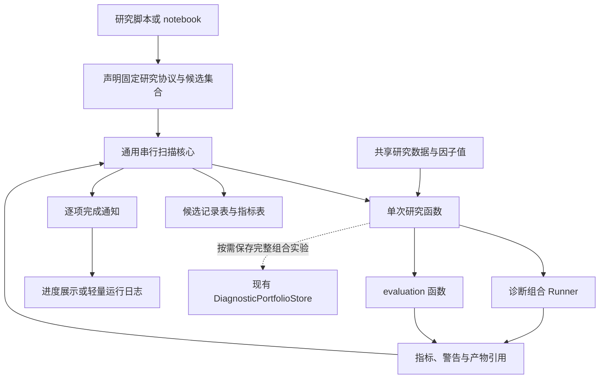
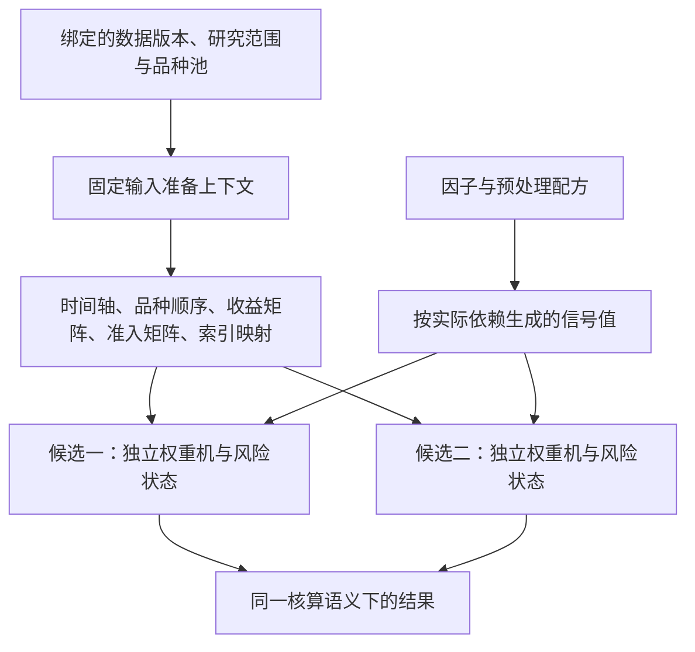

# 因子研究参数扫描与实验性能优化设计方案

## 1. 需求背景与当前基础

### 1.1 从一次真实参数扫描出发

因子研究已逐步进入“开展研究，并由研究中的实际阻力推动基础设施建设”的阶段。当前需要补齐的能力，是把 notebook 中重复编写的参数循环整理成可复用的研究工具，同时降低一次完整组合实验被反复调用时的开销。

直接需求来自 `tests/factors/diagnostic_portfolio/my_test_production_20261003.ipynb` 中标有“参数扫描”的 cell。该 cell 使用三层循环扫描动量因子回看窗口、组合调仓间隔和风险估计窗口，共执行 36 次诊断组合实验，最终保存每组参数对应的代理净收益 Sharpe。

| 扫描参数 | 当前取值 | 所属环节 | 改变参数后需要重新计算的主要内容 |
|---|---|---|---|
| `r` | 5、10、15 | 因子构造 | 动量因子值及其下游实验 |
| `h` | 10、20、30、40 | 组合调仓 | 调仓日程、权重路径及核算结果 |
| `vol_r` | 15、30、45 | 风险估计 | 风险估计、权重路径及核算结果 |

这里的 `h` 对应 `RebalanceConfig.interval`，表示全局时间轴上的调仓间隔。它与 evaluation 中的预测标签期限属于不同配置，命名和实验记录应分别表达。

这段代码暴露出三类相互关联的问题：

- 执行组织重复：每项研究都要重新处理参数枚举、进度、异常、指标提取和结果整理。
- 计算重复：只有 3 种动量因子构造，却计算了 36 次；同一研究数据的面板结构也被多次处理。
- 研究信息保留不足：最终结果只有参数到 Sharpe 的映射，缺少覆盖率、有效期数、失败记录和完整配方等解释信息。

因此，本方案同时讨论通用扫描工具、实验执行成本和研究结果契约。三者通过清楚的边界衔接，按阶段落地。

### 1.2 当前已经具备的能力

以下以本次设计时的代码为准。既有设计文档用于说明背景，不替代源码事实。

| 现有组件 | 已有能力 | 对本方案的意义 |
|---|---|---|
| `ResearchDataset` 与数据构建器 | 主面板、动态品种池、附属数据及请求配置 | 扫描调用方可以在候选循环外构建研究数据 |
| 因子库与预处理、合成组件 | 根据明确配方生成单列预测变量 | 单次研究函数负责组织这些领域计算 |
| `DiagnosticPortfolioExperimentRunner` | 信号转换为连续权重，计算收益、成本、净值、暴露、归因和绩效 | 是扫描器可以调用的一种业务执行路径 |
| `factors/evaluation` | IC、RankIC、回归、命中率、分组等评价函数 | 是扫描器需要支持的另一类调用场景 |
| `DiagnosticPortfolioStore` | 完整实验输入与结果存储、指纹、来源记录、加载与重放 | 完整产物直接复用现有存储能力 |
| Alpha101 批量实验脚本 | 批量运行、因子值复用、失败隔离、运行日志、跳过已有产物 | 为抽取公共执行能力提供第二个真实参考 |

Runner 的逐时点权重更新已经使用 NumPy 数组，运行前一次性展开面板，运行后一次性构建权重序列。但输入对齐和核算阶段仍有 pandas 操作，也有逐组 Python 回调。当前性能问题需要基于整条调用链分析。

本方案中的扫描接口均为拟议新增接口，尚非仓库现有可调用能力。本文是开发方案，本次交付不包含源码实现。

## 2. 设计目标与首期边界

### 2.1 设计目标

首要目标是让研究者可以把已有的单次研究流程包装成一个函数，提供候选参数后立即批量运行，并得到能继续分析、审计和关联完整产物的结果。

复用性主要体现在执行机制：组合实验和 evaluation 共用候选组织、进度通知、失败记录和结果整理。研究者仍能直接使用底层领域函数，不必先把研究流程改造成复杂对象体系。

可扩展性主要通过边界保留：候选集合与生成方式分离，扫描核心与领域计算分离，摘要与完整产物分离，固定输入与单次运行状态分离。未来扩展以新增真实用例为依据。

### 2.2 首期可交付范围

首期交付通用串行扫描、结构化结果记录，以及已识别 Runner 热点的局部优化。研究调用方同步把可直接复用的因子计算移到候选循环之外。

| 阶段 | 交付内容 | 主要完成条件 |
|---|---|---|
| 第一期 | 串行扫描、候选与结果契约、逐项通知、失败记录、Runner 局部提速、调用方复用因子值 | notebook 三维扫描和一个 evaluation 用例可以接入，原完整结果口径保持兼容 |
| 第二期 | 固定实验输入准备上下文 | 真实扫描测量证明重复准备行情、准入矩阵与索引映射值得进一步处理 |
| 第三期 | 摘要执行路径 | 输入复用后，完整结果物化仍明显占用扫描时间或内存 |
| 后续按需 | 恢复执行、并行调度、其他候选生成方法 | 已有明确规模需求，且身份、状态隔离与资源开销可验证 |

第一期不建设自动选优器、通用计算依赖图、中央实验注册服务、全局缓存或分布式执行系统。是否选择候选、如何评价稳健性，由研究流程显式决定。

本方案承接既有稳健性方案关于显式候选、共同样本和全部尝试记录的要求。旧方案将自动网格生成排除在其自身首期之外；本方案在独立扫描工具中增加轻量笛卡尔积便利函数，扩展执行能力，保留原研究比较约定。

## 3. 总体架构与职责划分

### 3.1 组件关系



通用核心只依赖普通候选描述和单次研究函数，不导入诊断组合、因子库或 evaluation 的具体实现。研究函数解释参数，构造领域对象，执行计算，提取需要比较的指标，并返回轻量结果。

第一期建议将公共能力集中放入一个普通模块 `factors/scanning.py`，与 `evaluation`、`diagnostic_portfolio` 处于同一研究域层次。研究配方与场景适配保留在研究脚本中，避免仅为复用几行构造代码建立新的适配器类层级。

### 3.2 为什么采用函数入口与轻量数据类

扫描的核心动作是对有限候选逐项调用同一个研究函数。当前没有需要由长期存活对象管理的连接、后台任务或复杂生命周期，因此普通函数入口已经足够表达执行过程。

少量数据类用于明确候选、单次观测与批次结果的契约。它们承载数据，不持有研究数据集、权重机或执行服务。

扫描会运行计算、生成运行身份并触发可选通知，因此入口是普通执行函数。候选生成和结果整理则尽量保持确定性。后续如果准备上下文需要管理共享数组，可单独引入上下文对象，无须同步把扫描核心改成多层继承的运行器。

### 3.3 职责边界

| 责任方 | 负责的事项 |
|---|---|
| 研究调用方 | 研究假设、固定协议、候选范围、标签与样本、配方构造、数据准备、因子值复用、结果选择规则 |
| 扫描核心 | 候选检查、顺序执行、耗时与状态记录、指标整理、逐项完成通知 |
| 单次研究函数 | 解释候选参数，调用已有领域组件，将领域结果映射为轻量观测 |
| 组合与评价组件 | 各自领域中的权重、收益、统计量和有效样本语义 |
| 现有 Store | 完整组合实验的输入快照、结果、完整性校验与重放 |
| 完成通知处理函数 | 进度展示、轻量记录写出等外部副作用 |

扫描核心不通过点号路径或反射自动修改任意配置对象，不推断哪些参数影响哪些计算，也不根据最高指标自动宣布研究结论。

## 4. 候选参数与最小接口

### 4.1 显式候选是基础表示

扫描器接收已经确定、顺序稳定的候选序列。每个候选由非空、批次内唯一的 `candidate_id` 和具体参数映射组成。

候选既可以由研究者手写，也可以由网格便利函数生成。存在条件依赖的参数，例如不同收获范式要求不同风险配置，应由调用方生成合法候选列表，或分别组织扫描，避免先生成大量已知无效组合。

`grid_candidates` 按参数映射的声明顺序及各轴取值顺序生成笛卡尔积，不自行排序或去重；空参数轴视为配置错误。生成的候选身份只保证在该候选表内可识别，不作为跨批次等价实验的证明。

首期参数使用可以明确保存的简单描述值。日期偏移、估计器或预处理器等复杂对象，以构造配方表达，再由研究函数实例化。完整数据集、函数对象和可变领域实例不放进候选参数。

### 4.2 最小接口示意

以下为拟议接口，只说明职责和最小数据流，不包含执行实现。

```python
from collections.abc import Callable, Mapping, Sequence
from dataclasses import dataclass, field
from typing import Any, Literal
import pandas as pd

@dataclass(frozen=True)
class ScanCandidate:
    candidate_id: str
    params: Mapping[str, Any]

@dataclass(frozen=True)
class ScanObservation:
    metrics: Mapping[str, float]
    warnings: tuple[str, ...] = ()
    artifact_refs: Mapping[str, str] = field(default_factory=dict)

@dataclass(frozen=True)
class ScanResult:
    scan_id: str
    records: pd.DataFrame
    metrics: pd.DataFrame
    metadata: Mapping[str, Any]

def grid_candidates(
    grid: Mapping[str, Sequence[Any]],
) -> list[ScanCandidate]: ...

def run_scan(
    candidates: Sequence[ScanCandidate],
    evaluate_one: Callable[[Mapping[str, Any]], ScanObservation],
    *,
    error_policy: Literal['raise', 'record'] = 'raise',
    on_complete: Callable[[Mapping[str, Any]], None] | None = None,
    metadata: Mapping[str, Any] | None = None,
) -> ScanResult: ...
```

接口采用参数映射作为研究函数输入，使研究函数可以单独运行。候选身份、耗时和异常记录由扫描核心补充。`metadata` 保存调用方声明的固定研究协议与来源信息，扫描核心不据此自动去重或验证研究有效性。

`frozen=True` 只限制数据类字段重新绑定，不意味着内部映射或数组不可变。执行前应保留候选参数的独立快照，并将参数副本交给研究函数，避免回调修改原始候选表。共享数据与因子值则由研究函数按只读输入使用。

### 4.3 输出信息

`records` 和 `metrics` 均以 `candidate_id` 为索引，保留输入候选顺序。参数映射独立放在记录列中，避免参数名与指标名冲突。

| 位置 | 最小信息 | 用途 |
|---|---|---|
| 批次结果 | `scan_id`、固定协议与来源信息 | 标识这次实际执行及研究背景 |
| `records` | 参数快照、状态、耗时、警告、异常类型与消息、产物引用 | 检查候选是否完成及如何追溯 |
| `metrics` | 调用方选择的标量指标 | 比较候选、制作参数切片和邻域汇总 |
| 完成通知 | 当前候选记录、所属批次身份及该项指标 | 逐项保存和更新进度 |

第一期状态使用 `success` 和 `failed`。业务上的退化信号、覆盖不足或统计量未定义，由异常类型、警告和指标缺失表达，不强行规定所有领域共用的“有效”标准。

同一批次约定固定指标集合。首个成功结果确定指标列，后续成功结果应保持一致；输出契约不一致直接报错。指标允许数值 NaN 表达未定义，禁止用零替代未定义统计量。布尔值、非数值和无穷值不作为有效指标。

失败候选保留记录行，对应指标为 NaN；全失败批次仍保留全部候选索引，指标列可以为空。成功返回但 Sharpe 为 NaN，与研究函数抛出异常，是两种不同状态。

## 5. 执行生命周期与运行记录

### 5.1 一次批量执行的过程

扫描开始前，检查候选身份、参数描述及执行选项，保存候选表和固定协议快照，生成新的 `scan_id`。这类批次配置错误在任何研究计算开始之前抛出。

随后按候选顺序执行：取参数副本，启动单调时钟，调用研究函数，检查返回契约，整理状态与指标，触发完成通知。进度在一项成功或失败已被记录后更新。

记录的 `elapsed_seconds` 覆盖研究函数调用，包含函数内部实际执行的数据计算和按需保存；不包含完成通知中的进度绘制或日志写入。若因子值已经提前计算或命中缓存，应另外记录预计算阶段耗时，避免仅凭逐候选时间低估整批成本。

完成通知得到可直接保存的独立记录快照，不接收整份历史结果表或完整领域结果。首期使用普通回调连接进度条和日志，不引入额外事件总线。

### 5.2 异常处理策略

默认 `error_policy='raise'`，适合开发和调试；研究函数异常时，先形成失败记录并通知，再抛出异常。批量探索明确使用 `error_policy='record'` 时，逐候选记录研究函数产生的 `Exception` 并继续后续候选。

参数检查、返回契约检查以及完成通知失败属于扫描使用或记录链路错误，直接抛出，不转换成普通候选失败。尤其是日志写出失败时应停止，让调用方知道记录已不完整。

`KeyboardInterrupt`、`SystemExit` 等控制退出保持传播，不被批量容错吞掉。因进程被终止而尚未完成的候选不伪记为成功或普通失败；完整候选清单与已有完成记录可用于辨别未完成项。

首期不自动重试，也不悄悄跳过退化候选。`raise` 模式或外部中断发生后不保证返回完整 `ScanResult`，需要保留部分进展的研究应启用逐项记录。

### 5.3 身份与全部尝试

`candidate_id` 表示声明候选；`scan_id` 表示一次扫描调用。同一候选重跑形成新的批次身份。现有 Store 的 `run_id` 表示某次完整组合实验的保存事件，通过 `artifact_refs` 关联。

第一期每个候选在一个批次内执行一次，故 `scan_id + candidate_id` 已足以区分执行记录。未来增加自动重试时再引入尝试编号。

不因参数值相同而自动合并候选，也不把最优项之外的记录删除。人工改变候选范围、经济方向、预处理或选择规则后，应保存新的研究批次及其与前批次的关系。

## 6. 研究可比性与结果解释

### 6.1 固定研究协议

一次扫描至少声明研究用途、数据与品种范围、评价时间轴、暖机安排、变化参数、固定配置、指标定义和选择用途。研究用途应区分探索、验证期选择和冻结后的诊断。

固定配置包括信号方向、收益或标签定义、年化因子、缺失政策、成本代理、调仓锚点等。若其中某项本身就是扫描轴，则显式写入候选，不将它隐藏在研究函数的分支中。

预处理拟合、监督合成与候选选择分别遵守其数据截止约定。足够长的前置历史用于因果暖机，不赋予使用未来样本拟合全局阈值的权限。

### 6.2 预测诊断与组合证据采用各自的比较口径

预测诊断比较时，应检查候选间共同有效的 `(timestamp, product)` 样本及共同有效组。相同日期范围或相同样本数不能代替实际索引一致性检查；组内因子为常数等情况仍可能导致有效组不同。

保留每个候选的原始覆盖率、有效行数以及共同样本造成的损失。若共同样本交集过小，应直接展示这一限制。

组合实验固定完整收益实现时间轴、动态品种池、缺失信号政策与暖机安排。缺失信号触发的空仓、退出品种产生的换手和相应成本均保留在路径中，不按候选分别删除低覆盖日期。组合路径不强制使用预测诊断的共同完整行。

正式比较应为最长回看提供足够前置历史，明确首个评价决策及其下一实现时点。若需要限定评分区间，应在共同实现时间轴上按相同公式统计，并保证计算净值和回撤时使用正确的区间收益。扫描器不自行切割时间轴。

### 6.3 明确当前绩效行的含义

当前 Runner 返回完整区间的 `gross`、`proxy_net`，以及从各候选首个非零总敞口附近开始统计的两行有效绩效。

扫描默认采用同一完整区间的 `proxy_net` 作为与当前 notebook 一致的探索口径，记录其包含的暖机空仓期。候选各自的有效绩效可以作为补充诊断；因为起始时间可能不同，不能仅替换成该行就声称完成公平比较。

切换到独立验证区间或样本外区间时，调用方应显式准备共同评分协议，而不是依赖扫描器猜测哪行绩效更合适。

### 6.4 多指标与参数区域

组合扫描建议至少保留代理净收益 Sharpe、收益、最大回撤、平均换手、有效期数和信号覆盖率。必要时补充总敞口、成本敏感性和品种贡献集中程度。

分析时保留原参数表，对一到两个参数做切片，其他参数固定或分面展示，观察稳定区域、方向变化和性能断崖。不能把不同调仓或风险配置下的高值混成一个没有条件解释的“参数平台”。

参数邻域汇总可计算相对预先声明中心的差值、有效比例和分布。首期扫描器不计算统一稳健性总分，不替研究者设定通用接受阈值。

同一评价数据上实际参与比较的候选和规则应完整保留，后续显著性分析再依正式假设定义检验族。扫描工具本身不提供选择偏差或多重检验已经被校正的保证。

## 7. 性能现状与问题定位

### 7.1 本次采样方法

在本次讨论中，使用 Conda base 的 Python 构造纯合成日频数据，直接运行当前 Runner：

- 时间轴为从 2001-06-01 开始的 6000 个工作日，品种数为 60。
- 各品种上市起点沿第 0 至第 2500 个时点分布，形成 285029 行 ragged long panel。
- 随机种子为 20261030；收益为均值 0、标准差 0.01 的正态随机值，信号为正态随机值。
- 已存在面板行的准入标记均为 True；没有板块归因附属输入。
- 使用 `ts_inv_vol_gross_one`，调仓间隔 10，波动率回看 30，最少样本 2，统一成本率 3e-5，`clip_bound=None`。

先用 cProfile 定位调用链，再去掉 profiler，用轻量方法包装计时重复完整运行三次，取各环节中位数。输入构建与 `DiagnosticSignal` 构造在计时之外；同一输入连续运行，缓存状态与第一次冷启动不同。

### 7.2 采样结果与解释

| 环节 | 普通计时中位数，秒 | 说明 |
|---|---:|---|
| 完整 `run()` | 1.3791 | 包含下列子过程及权重更新等其他工作 |
| `_compute_accounting_artifacts` | 0.9380 | 包含时间范围收集与核算阶段对齐 |
| `_collect_date_range_metadata` | 0.6692 | 两处逐时间组的 Python 回调 |
| `_verify_signal_index` | 0.2029 | 当前构造两份索引的 Python 集合 |
| `align_inputs` | 0.2321 | 包含上一行索引校验，不能重复累加 |
| `_align_weight_return_cost` | 0.0762 | 核算阶段权重、收益和成本对齐 |
| `build_panel_arrays` | 0.0640 | 将三个面板列展开为矩阵 |

这些环节存在包含关系，各行中位数也独立计算，不能直接相加得到总耗时。同一场景的 cProfile 完整耗时约 2.33 秒，采样工具放大了大量小函数调用的成本，普通计时更适合描述该场景的时间规模。

采样支持的结论是：当前代码至少存在两个可独立处理的热点，元数据中的逐组回调和索引集合校验。它没有证明真实研究的主要瓶颈永远位于这两处，也没有证明面板拼接不值得优化。

本场景没有测量因子构造、预处理、目标波动率协方差估计、完整存储以及峰值内存。真实市场数据的缺失结构、调仓频率、板块分类和硬件环境也可能改变排序。这里的数值是一次性诊断记录，不作为性能承诺或固定测试阈值。

### 7.3 按成本来源分层处理

单次运行中无必要的 Python 回调适合局部优化；候选间不变的计算适合复用；用户不消费的完整明细适合后续摘要路径。三者各自验证，不把所有耗时统一归因于 pandas 或 NumPy 的选择。

性能评估同时报告整批墙钟时间、预计算时间、每候选时间分布、内存占用及持久化成本。缓存将成本前移后，不能只比较命中缓存的候选时间。

## 8. 首期 Runner 优化方案

### 8.1 时间范围元数据批量归约

当前 `_collect_date_range_metadata` 使用逐组 `apply` 判断每个时间戳是否存在有效信号，以及总绝对权重是否非零。

首期将它们分别改为布尔序列的分组 `any`，以及绝对权重的分组 `sum` 后比较零。仍使用信号序列本身判断信号范围，保留索引排序、首末值、全程空仓和缺失标记的既有语义。

返回的 `date_range_meta` 键、Series 名称、字段顺序与值保持兼容；不要顺带调整有效绩效起点的算法。该元数据参与下游绩效，不能为了提速而省略。

### 8.2 信号索引校验的快速路径

当前 `_verify_signal_index` 总是执行 Python 集合差。首期优先增加索引完全相等的快速路径；非完全相等时，使用 pandas 索引成员判断定位额外行，并仅在异常时组织错误信息。

子集信号、顺序不同但元素合法的信号仍按既有主面板对齐规则处理。校验不能退化为只比较长度、索引名称或对象身份。超出主面板的信号继续明确报错，主面板与准入序列的索引要求保持不变。

改动局限于已识别热点，不同时重写输入拼接、时间轴构造和核算对齐，以便验证性能收益与行为变化的来源。

### 8.3 首期兼容性要求

保持 `DiagnosticPortfolioExperimentRunner(...).run()` 的调用方式与完整 `DiagnosticPortfolioResult` 契约。所有已有权重、收益、成本、归因、绩效和警告继续产生。

验证应覆盖 full panel 和 ragged panel、相同索引与子集索引、顺序差异、缺失信号、全程空仓、动态退出与持仓期缺失收益。离散结果和身份信息保持一致，浮点输出使用与既有测试相符的容差比较。

如果验证发现原有行为与研究语义冲突，应单独记录缺陷及必要修复，不能把改变收益口径的修复混在“等价提速”中。

## 9. 计算复用与后续性能演进

### 9.1 首期在调用方复用因子值

动量三维扫描中，每个回看窗口的因子只需计算一次，再用于不同调仓和风险配置。第一期直接在研究函数外构造按 `lookback` 索引的映射，即可把因子计算次数从 36 降到 3；组合实验次数仍为 36。

这只是减少重复计算次数，不表示整批耗时按相同比例下降。收益取决于因子计算占比。

缓存作用域限制在一次绑定了具体输入的研究调用中。示例中的 `lookback` 可作键，是因为因子类型、输入数据和其他配方均已固定。数据、预处理拟合窗口、样本掩码或因子定义改变时，需要新的作用域或更完整的键。

归一化、预处理和合成的拟合结果也有自己的依赖关系。尤其是 walk-forward 中，不能只按窗口长度缓存跨折使用的拟合对象。缓存完整的因果因子序列，也不能改变其后续在训练、验证与测试中的使用权限。

### 9.2 第二期准备上下文



当前 `PanelArrays` 同时包含固定的收益、准入和变化的信号。第二期可以分离固定准备结果与单次信号绑定，复用时间轴、品种顺序、矩阵及索引映射。

上下文应绑定具体输入快照或明确版本；只读约定与失效条件必须明确，不能仅因数据集对象相同就假设内容未被修改。不同动态品种池、评价范围或时间轴需要新的准备上下文。

矩阵化过程中应明确区分不存在的面板组合、已有行的缺失收益以及明确的 False 准入标记。ragged panel 的空格不能未经处理就转成布尔准入结果。连续权重和收益对齐也必须保留原有全局时间轴语义。

每个候选仍建立独立的权重机、风险历史、当前持仓和警告记录。固定输入数组可以共享；状态机不能从前一个候选继续运行。复用纯历史风险统计则需额外证明其估计配置、缺失政策和品种集合依赖一致，不列入第二期的必要范围。

### 9.3 第三期摘要执行

只有在前述优化完成后，完整归因或明细物化仍显著影响研究吞吐时，才增加摘要执行路径。

摘要路径与完整路径共享权重、收益、成本、缺失政策及必要绩效计算。可延迟的是未被扫描消费的明细和归因表；必要的数据有效性检查、警告和统计区间信息仍然保留。

摘要应使用明确的轻量返回契约，不把当前完整结果的必填字段批量改成 None，也不建立另一套独立的收益公式。被选中用于深入检查的候选，通过同一输入和配方再生成完整结果，并验证摘要指标一致。

### 9.4 并行化的前提

并行化应在串行成本和复用边界已经清楚后评估。Windows 进程启动、数据序列化和大面板复制可能抵消计算收益，线程收益也取决于实际热点。

后续应先测量任务粒度、内存峰值与输入传输成本，再决定进程或线程方案。当前闭包式研究函数适用于串行 MVP；引入进程执行时，再明确任务的可序列化入口与每个工作进程的数据初始化机制。

## 10. 存储与复现衔接

### 10.1 扫描摘要与完整实验产物

扫描摘要保存全部候选的参数、指标、状态和来源信息；完整实验产物保存权重、收益路径、归因和实际输入。两类数据量、消费方式与保存频率不同。

首期由完成通知处理函数写轻量日志，例如候选清单、固定协议和逐项 JSONL 完成记录；扫描结束后可保存普通指标表。该处理函数放在研究调用侧，按 UTF-8 写文本，不在扫描核心建立新存储框架。JSONL 的 NaN 指标写成 JSON 的 null，读取时恢复为缺失值，保留与数值零的区别。

需要完整组合证据时，由研究函数调用现有 `DiagnosticPortfolioStore.save`，将返回的 `run_id` 放入 `artifact_refs`。也可以先保存全部摘要，再对预先约定的基线、中心或关注候选重新生成完整产物。完整产物不要求对每个候选都保存。

默认情况下，研究函数内部保存失败会使该候选执行失败。如果研究希望区分“计算成功、存储失败”，应在调用侧明确记录这一附加状态，不能静默丢失产物引用。

### 10.2 完整配方与复现等级

现有 Store 记录组合实际输入、完整结果、配置和输入指纹、代码来源及运行环境，并支持输入重放。扫描不重新实现这些机制。

但组合输入重放不等于可以从原始研究数据重建因子。当前 notebook 中 `recipe={}` 的写法无法完整表达上游计算。扫描配方至少应记录因子构造参数、预处理与拟合安排、合成方法、固定组合配置、评价协议和随机种子等实际依赖。

候选参数保存变化部分，批次 metadata 保存固定部分，两者共同构成研究配方。实际数据标识和代码来源同样需要保留；只保存数据起止日期不足以说明输入内容完全相同。

简单的摘要记录不自动具备完整输入快照的复现等级。调用方应如实说明是“保留配方和指标”，还是“保存了可重放的组合输入”，以及上游数据是否仍可获取。

### 10.3 恢复执行的后续条件

首期不自动恢复。已有完成日志可供研究者检查并显式筛选剩余候选，但筛选前必须确认固定协议、完整参数、实际输入和代码来源仍匹配。

Alpha101 脚本当前按因子名与收获范式检查已有产物，这为批量脚本提供了跳过能力；通用参数扫描不能直接沿用这一等价判断，因为同名实验仍可能改变风险窗口、成本或数据。

未来自动恢复时，应区分候选配置身份和实际执行身份，并核验完整实验上下文及产物完整性。存在相同 `candidate_id`、文件名或摘要行，不能单独证明可以跳过重算。

## 11. 典型使用流程

### 11.1 动量因子、调仓与风险窗口扫描

下例为接入示意，省略数据构建和固定配置构造。`dataset` 已在候选循环外构建；`base_spec` 是使用 `ts_inv_vol_gross_one`、明确成本与缺失收益政策、非空风险配置的基础实验规格；`protocol` 保存研究范围、数据来源及固定配置。

该示例沿用当前 notebook 的完整实现时间轴和 `proxy_net` 探索口径，暖机空仓保留在结果中。独立验证区间的前置历史和共同评分处理，按第 6 节补充，不在此展开另一套区间核算代码。

```python
from dataclasses import replace
from factors.scanning import ScanObservation, grid_candidates, run_scan

values_by_lookback = {
    r: MomentumFactor(lookback=r).compute(dataset.main_panel)
    for r in (5, 10, 15)
}
candidates = grid_candidates({
    'lookback': [5, 10, 15],
    'rebalance_interval': [10, 20, 30, 40],
    'volatility_lookback': [15, 30, 45],
})

def evaluate_portfolio(params):
    values = values_by_lookback[params['lookback']]
    signal = DiagnosticSignal(
        name=f"momentum_{params['lookback']}", values=values,
        source_stage='raw', factor_name='momentum',
        recipe={'factor': 'MomentumFactor',
                'parameters': {'lookback': params['lookback']}},
    )
    spec = replace(
        base_spec,
        name='momentum_grid',
        rebalance=replace(base_spec.rebalance,
                          interval=params['rebalance_interval']),
        risk=replace(base_spec.risk,
                     volatility_lookback=params['volatility_lookback']),
    )
    result = DiagnosticPortfolioExperimentRunner(signal, dataset, spec).run()
    performance = result.performance.loc['proxy_net']
    return ScanObservation(
        metrics={
            'proxy_net_sharpe': float(performance['sharpe']),
            'total_return': float(performance['total_return']),
            'max_drawdown': float(performance['max_drawdown']),
            'mean_turnover': float(result.turnover.mean()),
            'n_periods': float(performance['n_periods']),
            'signal_coverage': float(
                values.loc[dataset.universe.eligible].notna().mean()),
        },
        warnings=result.warnings,
    )

scan = run_scan(candidates, evaluate_portfolio,
                error_policy='record', metadata=protocol)
```

这里同一 `spec.name` 可以对应多个候选，因为身份以候选表中的完整参数和批次记录为依据。保存到 Store 时，完整规格中的实际风险和调仓参数仍被记录。名称可以用于阅读，但不替代实验身份。

示例不在内存中累积全部 `DiagnosticPortfolioResult`。研究函数提取摘要后，完整结果可被释放；要保留的候选通过 Store 或明确的调用方策略管理。

### 11.2 evaluation 接入

评价用例采用相同的候选与执行接口，仅替换单次研究函数。下例使用现有 `ic_details` 的时序模式，返回的两项分别为 IC 和 RankIC 结果。

研究者应先构建 `evaluation_panels`：按回看窗口索引，每份面板包含 `factor`、`label`、`universe` 三列；标签定义、共同有效行、有效品种集合和最少观测要求均已按研究协议检查。共同掩码构造与有效组核对属于研究准备步骤，不能由本例中的 `nan_policy='drop'` 自动代替。

```python
from factors.evaluation.ic import ic_details

def evaluate_prediction(params):
    panel = evaluation_panels[params['lookback']]
    ic, rank_ic = ic_details(
        df=panel, mode='time_series', label_horizon=10,
        min_observations=100, annualization_factor=252,
        nan_policy='drop',
    )
    return ScanObservation(metrics={
        'mean_product_ic': float(ic.ic_summary.mean),
        'mean_product_rank_ic': float(rank_ic.ic_summary.mean),
        'n_valid_products': float(ic.ic_summary.n_valid),
    })

prediction_scan = run_scan(
    grid_candidates({'lookback': [5, 10, 15]}),
    evaluate_prediction, error_policy='record',
    metadata=prediction_protocol,
)
```

时序模式中的均值是有效品种 IC 的汇总，`n_valid` 是有效品种数，不能解释为日期数或全部面板观测数。固定标签期限属于 `prediction_protocol`；该期限与组合调仓间隔分别记录。

这两个用例证明通用性落在执行与结果契约上。扫描器不要求组合结果和 IC 结果拥有相同字段；各研究函数在自己的批次内提供一致的指标定义。

### 11.3 邻域分析与深入检查

扫描结束后，研究者将参数表与指标表按 `candidate_id` 关联，保留失败状态，再按固定条件制作参数切片、中心差值或邻域汇总。展示有效比例，避免只对成功候选展示漂亮区域。

候选范围、中心身份和选择用途在看结果之前记录。用于验证期选择的扫描可以形成冻结候选；冻结后查看测试邻域得到的是诊断证据，若据此继续改参数，应如实记录测试数据已经参与开发。

要深入解释某候选时，再加载已有完整实验或按原配方重跑，并核对摘要指标。第一期不额外建设图形报告系统。

## 12. 开发顺序、测试与验收

### 12.1 首期开发顺序

1. 固定最小契约：在普通模块内实现候选、观测、批次结果和网格便利函数，明确两张输出表及异常策略。
2. 完成串行执行：实现候选预检查、执行、计时、状态记录与完成通知；用轻量研究函数验证执行机制。
3. 接入两个真实用例：在研究调用侧接入动量三维扫描与一个 evaluation 扫描，补齐固定协议和因子值复用。Alpha101 脚本作为复用参考，首期不强制整体迁移。
4. 局部优化 Runner：逐项替换元数据回调与索引校验，保持完整结果兼容，分别检查等价性和耗时。
5. 完成真实研究验收：固定数据和候选表，比较手写循环与公共工具的结果、整批成本及记录完整性，保留性能测量方法和适用限制。

### 12.2 扫描核心测试

新增测试以 synthetic 数据和可控回调为主，从仓库根目录运行，不依赖真实行情文件。

| 场景 | 验证重点 |
|---|---|
| 规则网格和显式候选 | 顺序确定，候选与参数对应，条件候选可以直接输入 |
| 候选预检查 | 重复或空身份、非法选项、空轴在执行前报错 |
| 正常执行与多指标 | 两张表索引一致，输出值与逐项直接调用一致 |
| 返回契约 | 指标列一致；NaN 保留；非数值、无穷值和契约错误明确报错 |
| 单项失败与全失败 | 失败项保留参数和错误，后续行为符合异常策略 |
| 通知与中断 | 每项完成后通知，包含失败；通知错误和控制退出继续传播 |
| 输入与状态隔离 | 参数快照不被回调污染，候选次序变化不改变各自结果 |
| 重复执行 | 确定性研究的参数、指标与警告一致；批次身份和耗时允许不同 |

测试应验证行为和调用边界，不复制实现细节。可以用计数型研究函数验证因子构造只发生在不同因子参数上，但不把缓存机制植入扫描核心。

### 12.3 Runner 等价性与因果性回归

沿用现有组合实验测试结构，补足此次改动相关的索引和元数据边界。重点比较：

- 完全相同、合法子集、乱序及越界信号索引的行为。
- 信号有效范围、首末非零敞口、全程空仓以及 metadata 结构。
- full/ragged 面板上的权重、收益、成本、归因和绩效。
- `w_t` 只参与下一全局实现时点收益，最后一个实现时点不新建决策或虚构平仓成本。
- 品种池退出、持仓收益缺失和零权重收益缺失的处理与警告。
- 修改未来数据不影响此前已形成的权重；共享输入和因子值不被运行修改。

从仓库根目录使用 Conda base 执行 `python -m pytest` 的针对性子集，先覆盖新增扫描测试和诊断组合测试，再按改动影响覆盖 evaluation 与存储回归。文档交付阶段不新增这些测试，也不因只修改 Markdown 而运行真实数据库测试。

### 12.4 性能与研究验收

性能比较固定同一输入、参数、输出范围和机器环境，将输入构建、因子预计算、Runner、存储及整批墙钟时间分开记录。cProfile 用于定位，去掉 profiler 后重复计时确认改善；说明冷启动、重复运行次数及内存测量方法。

至少覆盖本次合成 ragged 场景和一组数据确实存在的真实研究输入。真实数据缺失时报告限制，不据此判断实现有缺陷，也不将合成提速直接外推到真实任务。

首期完成的研究侧标准为：36 项动量组合候选全部可追踪；因子值仅按 3 种回看构造；指定候选与直接调用结果一致；失败与未定义指标可辨别；evaluation 能使用同一公共执行接口；完整组合结果仍可按原方式保存和重放。

首期不预设提速倍数。要求提供热点改动前后的可重复测量，证明增加扫描记录后整批成本仍可解释，并明确剩余主要成本。

### 12.5 后续阶段的进入条件

当不同候选重复准备固定矩阵和索引成为显著成本时，进入准备上下文阶段；当完整结果物化或保留仍限制扫描规模时，设计摘要路径；当串行执行与内存、任务粒度基准表明并行有实际收益时，再扩展调度。

自动恢复还需要完整实验身份、输入一致性与产物完整性核验。更复杂的随机搜索或优化方法只负责产生新的显式候选，研究协议、单次执行和结果记录契约继续复用。

## 参考源码与相关设计

以下链接用于核对当前行为及设计承接关系；上文拟议的扫描接口尚待开发。

- [需求 notebook](../../tests/factors/diagnostic_portfolio/my_test_production_20261003.ipynb)
- [组合实验 Runner 与面板处理](../../factors/diagnostic_portfolio/experiment.py)
- [组合输入、配置和结果模型](../../factors/diagnostic_portfolio/models.py)
- [权重状态机](../../factors/diagnostic_portfolio/weights.py)、[风险估计](../../factors/diagnostic_portfolio/risk.py)、[核算与绩效](../../factors/diagnostic_portfolio/accounting.py)
- [组合实验存储](../../factors/diagnostic_portfolio/storage/store.py)、[配置序列化与指纹辅助](../../factors/diagnostic_portfolio/storage/serialization.py)
- [IC 与 RankIC 接口](../../factors/evaluation/ic.py)、[评价样本选择](../../factors/evaluation/common.py)
- [Alpha101 批量实验参考](../../research/experiments/alpha101/run_alpha101_experiment.py)
- [组合实验现有测试](../../tests/factors/diagnostic_portfolio/test_experiment.py)
- [因子研究闭环与组合实验层开发方向](<./20260924 因子研究闭环与组合实验层开发方向.md>)
- [诊断组合实验结果持久化设计方案](<./20261012 诊断组合实验结果持久化设计方案.md>)
- [因子合成模块组件开发方案](<./20261019 因子合成模块组件开发方案.md>)
- [因子研究的稳健性检验开发方案](<./20261022 因子研究的稳健性检验开发方案.md>)
