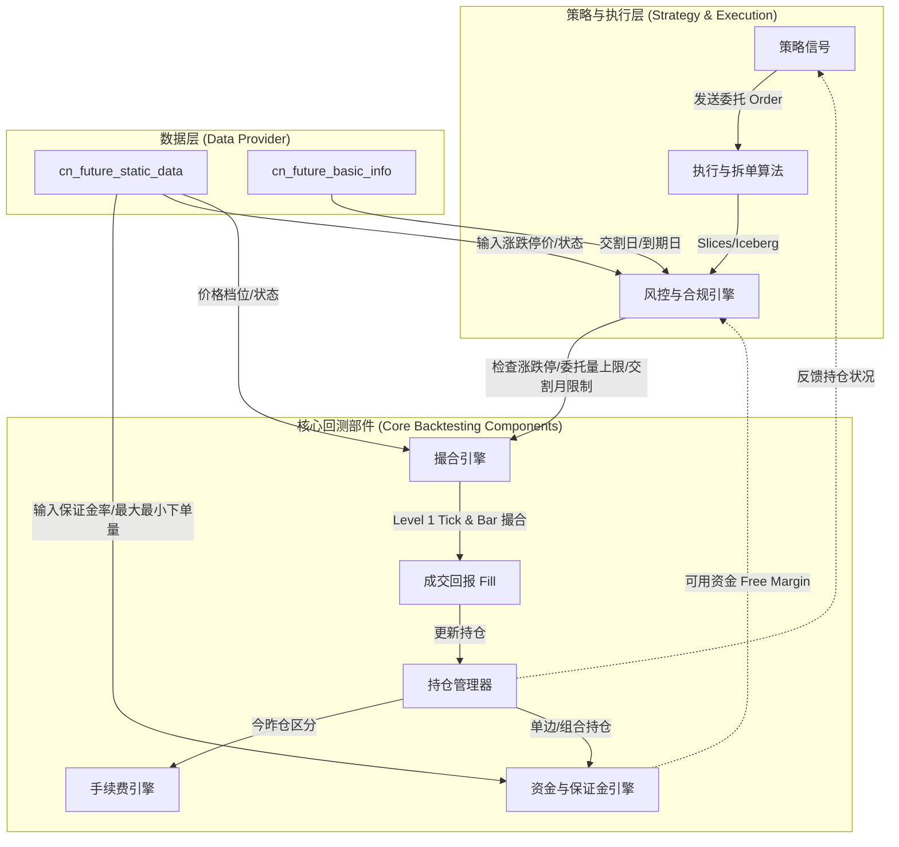

# 期货量化交易回测引擎数据字段与工业级需求分析

为了让您的回测引擎对标**百亿私募实盘标准**，在模拟数据和系统部件设计时，不能仅做简单的“多空盈亏统计”。工业级回测引擎需要高精度地模拟**资金占用、执行限制、合规风控以及交易所特有的结算机制**。

以下是针对您列出的 17 个关键数据字段，结合量化回测系统各部件（撮合引擎、资金与保证金引擎、风控与合规引擎、手续费引擎）的深度解析。

---

## 一、 核心字段详解与组件映射

### 1. 价格与订单限制类（撮合引擎 & 风控引擎）

#### 涨跌停价 (Limit Up/Down Price)
* **业务含义**：交易所规定的当日最高和最低交易价格。
* **回测组件**：**风控引擎 (Risk Engine)** & **撮合引擎 (Matching Engine)**
* **实盘标准与回测设计**：
  * **委托拦截**：在风控环节，任何超出涨跌停区间的委托（例如在跌停板下方挂单买入，或在涨停板上方挂单卖出）都会被直接拒单（Rejected by Gateway）。
  * **单边市撮合（板上交易模拟）**：当价格触及涨跌停价时，市场通常会出现“单边市”（涨停时只有买单排队，无卖单；跌停时只有卖单排队，无买单）。
    * *Level 1 Tick 撮合*：若 Bid1 价格等于跌停价且 Bid1 Volume 为 0（说明卖单挂在跌停板，没有买单），此时做多是无法立刻成交的。回测引擎必须模拟队列（Queue）排队或只允许反向交易（只能卖，不能买）。
    * *Bar 级别撮合*：若 Bar 的 High 等于涨停价或 Low 等于跌停价，不能简单按 High/Low 价全额撮合成交，必须判断是否“封板”（即盘中是否有持续无量封板状态）。如果是封板，策略的入场单通常无法成交，否则会严重高估策略收益。

#### 市价单/限价单 最大/最小下单量 (Max/Min Order Volumes)
* **业务含义**：单笔委托能发送的最大和最小合约手数。例如股指期货（CFFEX）限价单单笔最大 200 手，市价单单笔最大 50 手；商品期货通常为几百手至上千手。最小下单量通常为 1 手。
* **回测组件**：**风控引擎 (Risk Engine) / 执行算法 (Execution Algos)**
* **实盘标准与回测设计**：
  * **合规拦截**：实盘交易中，如果策略发送了单笔 300 手的股指限价单，API 会直接报错拒单。回测系统也必须在风控部件拦截此类订单，否则回测出的交易曲线是无法在实盘中执行的。
  * **拆单模拟（Slicing/Iceberg）**：百亿私募在实盘中通常拥有大资金，单次信号触发的下单量可能远超单笔最大限制。在回测中，执行算法组件必须能够模拟**自动拆单**（例如将 500 手拆成 3 笔发送），并叠加由于拆单带来的**时间延迟和市场冲击（Slippage & Market Impact）**。

#### 价格档位 (Price Level / Tick Size)
* **业务含义**：最小变动价位（例如螺纹钢为 1 元/吨，黄金为 0.02 元/克）。
* **回测组件**：**风控引擎 & 撮合引擎**
* **实盘标准与回测设计**：
  * **价格对齐校验**：委托价格必须是价格档位的整数倍（即 `(Price - RefPrice) % TickSize == 0`）。如果不符，交易所会废单。回测引擎需要在委托进入撮合前进行价格归整（Rounding）或直接废单拦截。
  * **Level 1 Tick 撮合填充**：使用 Bid1/Ask1 数据时，价格档位限制了挂单的密集度。在计算点差滑点时，最小变动价位是滑点单位计算的基准。

---

### 2. 资金、保证金与资产组合类（资金与保证金引擎）

这是对标“百亿私募实盘标准”最核心、最复杂的模块。百亿私募非常看重**资金利用率（Capital Efficiency）**，因此对保证金的模拟必须做到极致。

#### 多头保证金率 / 空头保证金率 (Long/Short Margin Rate)
* **业务含义**：开仓一手合约所需缴纳的资金占合约总价值的比例。
* **回测组件**：**资金与保证金引擎 (Account & Margin Engine)**
* **实盘标准与回测设计**：
  * **动态保证金率（极其重要）**：保证金率在回测中**绝对不能设为常数**。
    1. **临近交割月提高**：随着合约靠近交割期，交易所会逐步提高保证金率（如从 8% 提升至 15%、20% 甚至 50%）。
    2. **长假效应**：国庆节、春节等长假前，交易所和期货公司会统一上调保证金率（防范国际市场跳空风险）。
    3. **单边市/连续涨跌停**：当出现连续板时，交易所会实行风险控制，临时提高保证金率。
  * **期货公司加收 (Broker Margin)**：实盘中私募拿到的是“期货公司保证金率”，通常在交易所基准上加收固定比例（例如交易所 8%，期货公司加收 2%，实际为 10%）。回测引擎必须支持在交易所保证金数据上加上一个 `Broker_Surcharge_Rate`。
  * **资金冻结计算**：
    $$\text{冻结资金} = \text{持仓价值} \times \text{保证金率} + \text{挂单未成交部分冻结}$$
    回测中必须实时计算可用资金（`Free Margin`），若 `Free Margin < 0`，需模拟实盘的**强平风控**。

#### 是否使用大额单边保证金算法 (Large Margin Single-Side / SPBM)
* **业务含义**：国内大商所、郑商所实行的**单向大额保证金**政策，以及中金所逐步推行的 **SPBM (Securities & Futures Portfolio Margin)** 组合保证金系统。
* **回测组件**：**资金与保证金引擎 (Account & Margin Engine)**
* **实盘标准与回测设计**：
  * **单边保证金 (Same-Product Offset)**：若策略同时持有同一品种不同合约的多头和空头（例如：多 RB2610 100手，空 RB2612 80手），交易所仅收取大额单边（即 100 手多头）的保证金，而不是 180 手的双边保证金。
  * **SPBM 跨品种/跨期组合**：在股指期货与股指期权、或特定关联商品（如煤焦钢组合）之间，SPBM 算法通过评估组合的净风险（Net Risk）来大幅降低保证金占用。
  * **百亿私募的痛点**：对于多因子/套利策略，如果回测引擎使用简单的“双边保证金计算”，会**严重低估可用资金，降低回测中的实际杠杆率和年化收益率**，甚至导致不该发生的强平。因此，回测引擎必须在每日结算（Settlement）和盘中计算时，实现大额单边和组合保证金的计算逻辑。

#### 组合类型 (Combination Type)
* **业务含义**：定义哪些合约可以构成交易所认可的套利组合（如跨期套利组合、跨品种套利组合）。
* **回测组件**：**资金与保证金引擎**
* **实盘标准与回测设计**：
  * 该字段指示了合约在结算时是否能够申请“套利保证金优惠”。回测系统需要根据组合类型，在每日盘后结算时，将符合条件的持仓对冲，释放多余的保证金。

#### 持仓类型 & 持仓日期类型 (Position Type & Position Date Type)
* **业务含义**：
  * *持仓类型*：净持仓（Net）与双向持仓（Gross）。国内期货全为双向持仓（多空并存）。
  * *持仓日期类型*：今仓（Today's Position）与昨仓（Yesterday's Position）。
* **回测组件**：**持仓引擎 (Position Manager) & 手续费引擎 (Fee Engine)**
* **实盘标准与回测设计**：
  * **平今/平昨差异（极关键）**：上海期货交易所（SHFE）和能源交易中心（INE）严格区分平今和平昨。
    * 很多品种平今仓的手续费是平昨仓的数倍（即惩罚性平今费率，如某时期甲醇、纯碱平今费率极高）。
    * 策略在发出平仓信号时，必须明确是平今（CloseToday）还是平昨（CloseYesterday）。回测引擎的手续费计算模块必须追踪持仓的“日期类型”，准确计算手续费。否则，高频/日内策略的回测净值会因为手续费计算偏差而完全失真。

---

### 3. 合约生命周期与交割风险类（风控引擎 & 策略路由）

#### 合约到期日、开始交割日、最后交割日 (Expiration & Delivery Dates)
* **业务含义**：合约停止交易并进入交割流程的关键时间节点。
* **回测组件**：**风控引擎 (Risk Engine) & 策略滚动逻辑 (Roll Logic)**
* **实盘标准与回测设计**：
  * **限仓与交割禁令（百亿私募核心红线）**：
    * **商品期货非法人户无法交割**：国内商品期货规定，普通机构投资者（私募产品通常属于“非法人户”）和个人投资者**不允许进入交割月**，或者持仓不能带入交割月临近交易日。
    * **持仓梯度限仓**：临近交割月时，交易所对单个账户的最大持仓量有极严格的梯度限制（如从 1000 手限制到 100 手，最后限制为 0 手）。
  * **回测自动强平/强制换月**：风控引擎必须在临近交割日/开始交割日前，强制将策略的持仓平仓或提醒换月。如果在回测中将商品期货持仓持有到了“最后交割日”之后，说明回测逻辑出现了严重漏洞。

#### 合约生命周期状态 / 当前交易状态 (Lifecycle & Trading Status)
* **业务含义**：
  * *生命周期状态*：上市（Listed）、退市（Delisted）、暂停（Suspended）。
  * *当前交易状态*：集合竞价（Auction）、连续交易（Continuous）、暂停交易（Halt）。
* **回测组件**：**策略路由器 (Strategy Router) & 撮合引擎**
* **实盘标准与回测设计**：
  * **防止“未来函数”与无效交易**：
    * 在退市或暂停交易状态下，撮合引擎必须拒单。
    * 在集合竞价期间（如 08:55 - 09:00），交易指令只能以集合竞价撮合机制（单一定价）处理，不能按连续交易（Level 1 盘口直接对冲）撮合。
    * 换月逻辑必须依赖“生命周期状态”——不能在合约上市前或退市后读取其行情或对其下单。

---

## 二、 工业级回测引擎架构与数据字段交互图

---

## 三、 给您的下一步开发建议

1. **统一代码大小写规范**：
   * 针对您在笔记中提到的“大小写区分”问题：工业级系统内部推荐**统一转换为大写**（如在大连商品交易所的 `lh` 转换为 `LH`），或者使用统一的规范化函数（Normalizer）。这能避免在多因子合并或数据库 Join 时因为大小写不匹配导致的数据丢失。
2. **细化手续费与今昨仓追踪**：
   * 建议在您的持仓数据结构（`Position` class）中，不仅记录 `volume`，还要拆分为 `today_volume` 和 `yesterday_volume`。
   * 编写手续费计算模块时，必须接入“平今费率”和“平昨费率”，并优先平扣不同类型的持仓（通常遵循“平今优先”或策略指定原则）。
3. **分阶段实现保证金引擎**：
   * **第一阶段**：实现基础的多空双边保证金计算（用合约当前结算价/收盘价 * 保证金率 * 乘数）。
   * **第二阶段**：引入“单向大额保证金算法”，针对同一品种的多空持仓进行对冲。这能让您的策略回测资金占用与实盘私募账户完全对齐。
