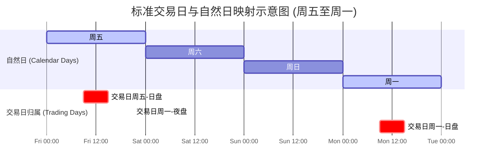
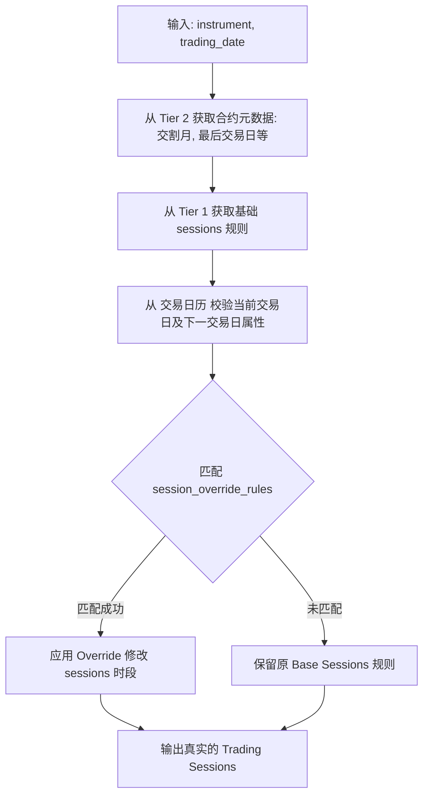

# 中国期货市场交易规则特殊安排研究报告 (Session Override Rules)

本报告系统梳理了中国期货市场（SHFE、DCE、CZCE、CFFEX、INE、GFEX）历史及现行的所有交易时段特殊安排规则（即 `session_override_rules`）。

在量化交易系统（尤其是历史回测和实盘风控/交易引擎）的设计中，准确处理交易时段的特殊安排至关重要。若处理不当，会导致回测产生“未来函数”或时间戳对齐错误，而在实盘中则会触发柜台拒单或导致系统在清算时出现严重异常。

---

## 一、 交易日与自然日的核心映射逻辑

在中国期货市场，**交易日（Trading Day）**与**自然日（Calendar Day）**并不是一一对应的。理解这一逻辑是设计所有特殊安排规则的基础。

1. **基本定义**：
   对于一个开设夜盘（连续交易）的交易日 $T$：
   - **夜盘（连续交易）**：发生在自然日 $T-1$（或上一个交易日）的晚上（通常为 21:00 至次日凌晨 02:30/01:00/23:00）。
   - **日盘**：发生在自然日 $T$ 的白天（上午 09:00 - 11:30，下午 13:30 - 15:00）。
   - **归属关系**：自然日 $T-1$ 的夜盘和自然日 $T$ 的日盘，在业务语义上**属于同一个交易日 $T$**，使用相同的交易日结算。

2. **周末周一的特殊映射**：
   - 周五白天的交易属于交易日**周五**的日盘。
   - 周五晚上的夜盘（例如 21:00 开启的交易）属于交易日**下周一**的夜盘。
   - 周六和周日全天无交易，周日晚上无夜盘。
   - 周一白天的交易属于交易日**周一**的日盘。



---

## 二、 中国期货市场历史上存在的四类 Override 规则

中国期货市场在发展过程中，为应对市场流动性变化、防控交割风险以及应对长假外部风险，演化出了以下四类 `session_override_rules`：

### 规则一：法定节假日前一工作日无夜盘

> [!IMPORTANT]
> **规则定义**：在国家法定节假日（不含双休日）前的最后一个工作日（交易日）当晚，期货市场不进行连续交易（取消夜盘）。

#### 1. 执行逻辑与临界情况
- **基础场景**：若周五是端午节假期（休市），则周四白天照常交易，**周四当晚无夜盘**。周五、周六、周日休市，下周一白天正常开市。
- **周末与假日的复合场景（易错点）**：
  - 若**周一是法定节假日**（如清明节放假）：
    - 周五白天的交易属于交易日周五的日盘。
    - **周五当晚无夜盘**。这是因为，若周五晚上有夜盘，该夜盘属于交易日“下周二”（因为周一是假日不交易），但由于跨越了长达3天的假期，为防止外盘剧烈波动导致隔夜风险，交易所规定必须关闭周五晚上的夜盘。
    - 下周一休市。
    - 下周二白天正常开盘，**下周二的前一晚（周一晚）无夜盘**。下周二当晚恢复夜盘交易（属于交易日周三的夜盘）。
- **撤单时间窗口（集合竞价顺延）**：
  - 正常有夜盘时，交易日开盘集合竞价在夜盘前（20:55-21:00）进行，日盘前不设集合竞价（仅支持在 08:55-09:00 撤销夜盘未成交单）。
  - 若因节假日**取消夜盘**，则在节后第一个交易日（如周一或假期结束后的首个工作日）的日盘开盘前，顺延举行开盘集合竞价（08:55-09:00，其中 8:55-8:59 为申报/撤单，8:59-9:00 为撮合）。

#### 2. 适用交易所与品种
- **交易所**：上海期货交易所 (SHFE)、大连商品交易所 (DCE)、郑州商品交易所 (CZCE)、上海国际能源交易中心 (INE)。
- **品种**：上述四大交易所中所有**已开设连续交易（夜盘）的品种**（如贵金属、有色金属、黑色系、化工、部分农产品）。
- **特殊排除**：中金所 (CFFEX) 和广州期货交易所 (GFEX) 本身未开设任何夜盘交易，故不涉及此规则。

#### 3. 实施历史与起止时间
- **开始时间**：自 **2013 年 7 月 5 日** 晚上上海期货交易所率先推出黄金和白银的连续交易（夜盘）起，该“假期前夕暂停夜盘”的规则即作为首批风控配套条款同步实施，并在此后各大交易所增设夜盘品种时成为统一的行业惯例。

---

### 规则二：最后交易日提前收盘 / 调整交易时间

> [!WARNING]
> **规则定义**：部分合约在最后交易日（到期日/交割日），为了配合最终结算价的计算以及交割交收的准备工作，会在白天提前收盘（通常只交易半天，或者比常规时间提前几十分钟收盘）。

#### 1. 中金所国债期货 (CFFEX TS / TF / T / TL)
- **常规交易日交易时段**：
  - 历史阶段（2013年9月6日至2020年7月17日）：09:15 - 11:30，13:00 - 15:15
  - 现行阶段（2020年7月20日至今）：09:30 - 11:30，13:00 - 15:15
- **最后交易日交易时段**：
  - 历史阶段：09:15 - 11:30（下午不交易，提前于 11:30 收盘）
  - 现行阶段：**09:30 - 11:30**（下午不交易，提前于 11:30 收盘）
- **实施历史**：
  - 5年期国债期货 (TF)：自 **2013 年 9 月 6 日** 上市起执行最后交易日 11:30 提前收盘。
  - 10年期国债期货 (T)：自 **2015 年 3 月 20 日** 上市起执行。
  - 2年期国债期货 (TS)：自 **2018 年 8 月 17 日** 上市起执行。
  - 30年期国债期货 (TL)：自 **2023 年 4 月 21 日** 上市起执行。
- **调整变化**：**2020 年 7 月 20 日**，中金所为了配合商业银行参与国债期货试点，以及错开央行公开市场操作结果发布时间（9:20），将国债期货常规及最后交易日的开盘时间统一由 09:15 推迟至 **09:30**，收盘截止时间保持不变。

#### 2. 中金所股指期货 (CFFEX IF / IH / IC / IM) —— 【历史已取消规则】
- **常规交易日交易时段**：
  - 历史阶段（2010年4月16日至2015年12月31日）：09:15 - 11:30，13:00 - 15:15
  - 现行阶段（2016年1月1日至今）：09:30 - 11:30，13:00 - 15:00（与A股股票现货时间完全对齐）
- **最后交易日交易时段**：
  - 历史阶段（2016年前）：**09:15 - 11:30，13:00 - 15:00**（比正常交易日提前 15 分钟收盘）。
  - 现行阶段（2016年起）：**09:30 - 11:30，13:00 - 15:00**（与常规交易日一致，无提前收盘）。
- **规则背景与实施历史**：
  - **2016年前**：由于当时股指期货收盘比股票市场晚15分钟（便于提供对冲缓冲），但最后交易日必须在下午 15:00 结束交易以计算交割结算价（交割结算价为沪深300指数最后2小时的算术平均价），因此最后交易日必须提前15分钟（即 15:00）收盘。
  - **2016年起**：为配合指数熔断机制的推出，中金所将股指期货的日常交易时间缩短为与A股一致的 9:30 - 15:00。因此，自 **2016 年 1 月 1 日** 起，最后交易日提前收盘的特殊规则失效（因日常也于15:00收盘）。

---

### 规则三：交割月及临近交割月无夜盘

> [!CAUTION]
> **规则定义**：当商品期货合约进入交割月份，由于流动性枯竭且交割手续复杂，为防范异常波动风险，交易所会强制取消该合约的连续交易（夜盘），仅保留日盘交易。

#### 1. 执行逻辑与临界时间点（开发核心难点）
- **暂停触发时间**：通常规定自**交割月份第一个交易日起**，该合约不再进行连续交易。
- **自然日视角的临界处理**：
  - 假设主力合约为 `rb2607`（螺纹钢2607合约），其交割月为2026年7月。
  - 7月的第一个交易日为 7 月 1 日（周三）。
  - 根据交易日定义，7 月 1 日交易日的“夜盘时段”发生在 **6 月 30 日（周二）晚上 21:00**。
  - **因此，`rb2607` 合约从 6 月 30 日晚上 21:00 起，就不能再进行夜盘交易了。**
  - 在系统的判定逻辑中，必须提前通过 `effective_date` 或“合约到期日前1个月的最后一个工作日晚上”将该合约剔除出夜盘可交易列表。

#### 2. 适用交易所与品种范围
- **适用交易所**：上海期货交易所 (SHFE)、大连商品交易所 (DCE)、郑州商品交易所 (CZCE)、上海国际能源交易中心 (INE)。
- **品种**：上述交易所有夜盘的全部商品期货品种。
- **实施历史**：自夜盘制度推出以来逐步推行，并在各交易所的《交割管理办法》或各品种的《期货业务细则》中标准化。

---

### 规则四：特定历史事件/政策性临时暂停

在极端市场环境下，监管部门或交易所会通过行政指令或熔断机制，在特定时间段内整体取消夜盘或提前结束交易。

#### 1. 2020 年疫情防控期间整体暂停夜盘
- **具体规则**：国内四大期货交易所及能源中心整体暂停所有品种的夜盘交易。
- **暂停期间**：**2020 年 2 月 3 日（周一）当晚**起暂停，至 **2020 年 5 月 6 日（周三）当晚**起恢复。
- **回测系统影响**：在这长达3个月的历史区间中，国内所有的商品期货品种在 21:00-02:30 均无任何 TICK 或 K线数据，日盘开盘前自动执行集合竞价。系统在此区间必须停用夜盘时段生成逻辑。

#### 2. 2016 年 1 月指数熔断机制下的交易暂停
- **具体规则**：2016年1月，A股实施指数熔断机制，当沪深300指数触发 7% 阈值时，全天暂停交易（股市及中金所股指期货同步提前收盘）。
- **发生日期与提前收盘时间**：
  - **2016 年 1 月 4 日**：13:33 触发 7% 熔断，股指期货及现货全天提前收盘。
  - **2016 年 1 月 7 日**：09:59 触发 7% 熔断，股指期货及现货全天提前收盘（当天仅交易15分钟）。
- **回测系统影响**：回测系统必须在此两天对应的交易日对交易时段做强制截断，否则会导致回测与实际行情严重失真。

---

## 三、 特殊规则历史与现状汇总表

| 规则类型 | 适用对象/品种 | 常规交易时段 | 特殊安排交易时段 | 实施历史与起止时间 | 状态 |
| :--- | :--- | :--- | :--- | :--- | :--- |
| **节假日前夕无夜盘** | 所有开设夜盘的商品期货合约 | 21:00 - 次日02:30等 | **无夜盘** | 2013-07-05 至今 | **现行** |
| **国债期货最后交易日** | CFFEX TS / TF / T / TL | 09:30 - 11:30<br>13:00 - 15:15 | **09:30 - 11:30** (下午闭市) | 2013-09-06 至今 (2020年7月将开盘由9:15改至9:30) | **现行** |
| **股指期货最后交易日** | CFFEX IF / IH / IC / IM | 09:15 - 11:30<br>13:00 - 15:15 | **09:15 - 11:30**<br>**13:00 - 15:00** | 2010-04-16 至 2015-12-31 | **历史** (2016年后因日常提前收盘而不再特殊) |
| **交割月份无夜盘** | 所有开设夜盘的商品期货合约 | 21:00 - 次日02:30等 | **无夜盘** (自交割月前一工作日晚生效) | 2013年夜盘上线至今逐步标准化 | **现行** |
| **新冠疫情整体暂停** | 所有开设夜盘的商品期货合约 | 21:00 - 次日02:30等 | **无夜盘** (全市场夜盘强制关停) | 2020-02-03 至 2020-05-06 | **历史** |
| **指数熔断提前收盘** | CFFEX 股指期货 / A股现货 | 09:15 - 15:15 | 触发5%暂停15分；**触发7%全天提前结束** | 仅发生在 2016-01-04 和 2016-01-07 | **历史** |

---

## 四、 交易系统 session_override_rules 设计落地建议

在我们的期货交易系统中，若要优雅地处理这一系列特殊规则，必须在数据库和统一门面（`TradingRuleService`）中采用**声明式（Declarative）**的设计。

### 1. 数据结构设计 (YAML / Tier 1 层面)
在品种元数据中，我们可以定义 `session_override_rules` 列表，分为规律性规则（基于到期日、交割月份）和特定日期安排。

```yaml
# 示例：大商所铁矿石 (I.yaml) 中的交易时段及覆盖规则
product: I
exchange: DCE

sessions_history:
  - effective_date: "2020-05-06"
    day_sessions:
      - ["09:00", "10:15"]
      - ["10:30", "11:30"]
      - ["13:30", "15:00"]
    night_sessions:
      - ["21:00", "23:00"]

session_override_rules:
  # 规则一：交割月无夜盘
  - type: "delivery_month_no_night"
    trigger: "enter_delivery_month"      # 进入交割月（交易日视角）
    action: "disable_night_session"
  
  # 规则二：节假日前一工作日无夜盘
  - type: "holiday_eve_no_night"
    trigger: "is_holiday_eve"            # 判断下一个交易日是否为节假日
    action: "disable_night_session"

  # 规则三：历史特定区间临时整体暂停夜盘（如2020年疫情）
  - type: "date_range_override"
    start_date: "2020-02-03"
    end_date: "2020-05-05"
    action: "disable_night_session"
    description: "COVID-19 Night Session Suspension"
```

```yaml
# 示例：中金所国债期货 (TF.yaml)
product: TF
exchange: CFFEX

sessions_history:
  - effective_date: "2020-07-20"
    day_sessions:
      - ["09:30", "11:30"]
      - ["13:00", "15:15"]
    night_sessions: []

session_override_rules:
  # 规则四：最后交易日提前收盘
  - type: "last_trade_day_early_close"
    trigger: "is_last_trade_date"        # 当交易日等于合约的最后交易日时触发
    action: "replace_sessions"
    target_sessions:
      day_sessions:
        - ["09:30", "11:30"]             # 剔除下午交易时段
      night_sessions: []
```

### 2. 统一门面 (TradingRuleService) 运行逻辑
当风控、回测或持仓管理器调用门面时，其输入为 `(instrument, trading_date)`。服务内部通过以下管道处理：



通过这一套设计，我们可以将中国期货市场极其复杂的历史、当前规则完美抽象，使得核心撮合、清算及回测引擎的底层代码无需编写任何 Ad-hoc（临时硬编码）代码。
