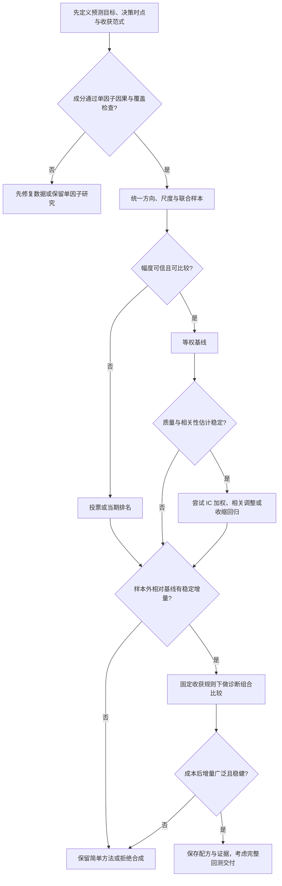

# CTA 因子合成框架与方法论：从成分选择到增量价值验证

> 文档定位：面向已经完成单因子研究和诊断组合实验、准备学习多因子合成的研究者。本文讲研究方法，不是因子合成模块的代码设计或已实现功能说明。文中的合成算法、`CompositeFactor` 与统一编排均属于**待开发设计**；当前项目状态见第 12 节。

## 1. 先看全局：合成在研究链路中的位置

因子合成解决的问题是：若若干因子各自含有对未来收益的预测信息，怎样把它们压缩为**一个有明确时间语义的预测变量**，使信息更稳定、覆盖更广，或者提供单因子没有的边际信息。输出仍是因子值，不是合约张数、订单或收益曲线。

```text
研究问题与可收获任务
  → 定义标签、品种池和决策时点
  → 单因子计算、预处理及独立诊断
  → 候选成分筛选、方向与尺度对齐
  → 用训练期信息确定合成规则
  → 逐时点产出复合因子
  → 与单因子、等权基线作样本外统计比较
  → 使用同一诊断组合规则比较权重、成本与代理收益
  → 稳健性检查和研究者决定是否交付
```

需要区分两次映射：

$$
\underbrace{(z^{(1)}_{i,t},\ldots,z^{(K)}_{i,t})
  \xrightarrow{\text{合成 } C_{\theta_t}} s_{i,t}}_{\text{因子层：多个信息源}\rightarrow\text{一个预测变量}}
\qquad
\underbrace{s_{\cdot,t}\xrightarrow{\text{收获规则 }H_t}w_{\cdot,t}
  \xrightarrow{r_{\cdot,t+1}}R^{\mathrm{gross}}_{t+1}}_{\text{诊断组合层：预测变量}\rightarrow\text{研究权重与收益}} .
$$

同一复合因子可以在不同收获规则下产生不同研究收益；同一收获规则也可以公平比较若干单因子和复合因子。因此，不要用“合成权重”指代“品种仓位”：前者在因子之间分配信息源权重，后者在品种之间分配研究风险。两者的维度、估计对象和失效方式均不同。

### 1.1 最小记号与时间约定

| 符号 | 含义 |
|---|---|
| $i,t,k$ | 品种、全局决策时点、成分因子 |
| $x^{(k)}_{i,t}$ | 原始第 $k$ 个因子；只能依赖时点 $t$ 已可见的信息 |
| $z^{(k)}_{i,t}$ | 第 $k$ 个因子按其配方预处理后的值 |
| $Z_t$ | 当期合格品种 × $K$ 个成分的因子矩阵；研究数据底表为长表索引 `(timestamp, product)` |
| $y^{(h)}_{i,t}$ | 从 $t$ 之后开始、未来 $h$ 期的研究标签 |
| $\theta_t$ | 在 $t$ 决策前已确定的合成参数，可为固定权重、回归系数或模型状态 |
| $s_{i,t}$ | 复合因子值；是信号输入，不是仓位 |
| $w_{i,t}$ | 收盘后根据 $s_{\cdot,t}$ 确定的连续研究权重 |
| $r_{i,t+1}$ | 下一研究期的单期收益 |

若 $t$ 日收盘后才知道全部成分值，则该时点的研究权重只能配对下一期收益：

$$R^{\mathrm{gross}}_{t+1}=\sum_i w_{i,t}r_{i,t+1}.$$

未来 $h$ 期标签用于估计和诊断预测关系。$h>1$ 时，相邻日期标签通常相互重叠，不能把每日的 $h$ 期标签逐日连乘成净值。预测期限、信号更新频率、调仓频率和实际持有期要分别记录。当前诊断组合使用主面板的单期 `True_Return` 并按全局时间轴配对下一期；它的收益是连续合约研究代理收益，完整交易回测还需要真实合约、移仓与执行语义。

### 1.2 时序与截面是两种问题

时序 CTA 问“这个品种当前信号能否预测它自己未来的方向或幅度”；截面多空问“同一时点哪些品种相对更强”。同一个原始因子可以被不同方式评价，但预处理尺度和收获规则要与问题匹配。时序信号常需要品种内部的历史尺度；截面排名重视同一时点的相对顺序。不要把全市场截面 IC 直接当作每个品种的时序预测能力。

### 1.3 先选优化目标，再选算法

“最优合成”没有脱离任务的统一定义。若目标是幅度预测，可最小化训练期均方误差 $\sum(y-s)^2$；若目标是线性关联，可最大化 $s$ 与未来收益的 Pearson 相关；若下游只按名次建仓，可关注排序关系；若目标是代理净收益，还须把权重映射、风险和成本一起放进实验。四者的最优系数未必相同。先写清“预测哪个标签、供哪一种组合规则使用”，再比较算法，避免拿某个目标上拟合最好的模型去宣布另一目标也最好。

## 2. 先选成分，再谈权重

合成不能替代单因子研究。每个候选因子至少应有可解释的经济或行为机制、明确的数据可得时间、目标标签和适用的收获范式。以下检查按“加入一个成分是否有理由”组织，而不是只按单因子 IC 排序：

1. **可信度**：因子是否用到了当时不可见的行情、期限结构、分类或未来标签？动态品种池过滤是否也遵守当时的信息集？
2. **独立有效性**：时序因子看分品种与跨品种的一致性；截面因子看逐期统计、分组或排名结构。训练期的偶然高 IC 不是独立有效性。
3. **互补性**：查看成分值相关、排序相关、预测误差相关、所依赖的经济驱动及市场状态。数值低相关未必意味着预测信息互补；数值高相关也可能有不同状态下的增量。
4. **边际性**：在既有成分已知时，新成分是否改善条件预测或固定组合规则下的样本外结果？该问题比“新因子本身是否显著”更接近加入合成的目的。
5. **可部署性**：覆盖率、更新延迟、热身期、缺失模式、换手和数据维护成本是否允许稳定产出。

例如，动量与展期收益率可能来自不同的市场机制，因此值得检验互补性；但不能仅凭名称不同就认定它们独立。可以从“两个机制清楚的成分 + 等权基线”开始，之后每加一个成分都重新检验边际价值。

## 3. 把因子矩阵变成可比输入

### 3.1 方向：正值表示什么

先冻结标签口径，再在训练期确定每个因子的预测方向 $d_k\in\{-1,+1\}$，令 $\tilde z^{(k)}=d_kz^{(k)}$。常用约定是“值越高，预期目标收益越高”。若训练期证据不足以稳定确定方向，可保留待验证或排除该成分。用全样本 IC 的符号翻转历史信号，会把未来结果写回过去。

方向可能随品种、状态或预测期限变化。若必须针对每个品种分别定义符号，相关规则也应当在训练期冻结；样本少时逐品种选择更易过拟合。

### 3.2 尺度、极端值与顺序

原始动量百分比、展期收益率和仓单变化率的量纲不同，直接相加通常相当于按数值尺度隐式加权。可选操作包括因果的滚动时序标准化、当期截面标准化、稳健尺度、排名或分位数映射。选择依据是下游任务：

| 目标 | 常见输入处理 | 代价 |
|---|---|---|
| 保留幅度信息的时序 CTA | 品种内部滚动尺度、稳健缩尾 | 窗口不足或波动状态变化会改变尺度 |
| 横截面相对排序 | 当期截面标准化或秩 | 秩会丢失原始幅度，截面太小时不稳定 |
| 只看方向共识 | 符号/分箱 | 丢失置信强弱与细微差别 |

先清洗非有限值，再按明确顺序执行缩尾、尺度变换、中性化等步骤；顺序改变就意味着不同因子。所有窗口、拟合参数和变换顺序都应进入配方。使用全样本均值、分位数或标准差生成历史可交易信号属于未来信息泄漏。当期截面变换可以使用当期已知的合格品种，但不能事后按未来数据回填品种池。

### 3.3 对齐与缺失不是一个简单的 `dropna`

合成矩阵以研究面板的 `(timestamp, product)` 为索引，同时保留动态准入掩码。先确定研究资格，再记录每一成分缺失的原因：因子暖机、原始数据缺失、上市前不存在、品种池排除、预处理失败。不能把“不存在的品种”当作因子值零，也不能让某个算子的缺失处理悄悄改变样本范围。

三种典型政策：

- **严格**：任一必需成分缺失则复合值缺失；解释简单，但覆盖率可能下降。
- **可用成分重归一**：只用现有成分，按其权重重新归一；覆盖率较高，但不同样本代表不同配方，须记录有效成分及有效权重。
- **投票弃权**：缺失成分不投票；适用于表决类合成，必须定义最低有效票数和平票规则。

这些是研究选项，不是当前项目已实现的复合因子政策。评估缺失政策时，应同时报告覆盖率和共同样本上的效果：如果复合因子只覆盖容易预测的时期，表面性能可能来自样本筛选。

### 3.4 相关、中性化、正交化：到底去掉了什么

成分相关矩阵 $\operatorname{Corr}(z^{(j)},z^{(k)})$ 描述数值共动；残差相关和条件回归描述在其他因子已知后还剩多少信息。比较相关系数时要固定同一时点、同一品种池、同一有效样本，并分别观察整体、滚动和市场状态。对于时序信号，还要避免将跨品种的共同趋势误读为每个品种内的独立预测。

中性化是从信号里剔除某些已知暴露；正交化是在成分之间重新定义坐标。二者都可能改善识别，也可能删掉真实可收获的信息。例如若目标组合允许板块方向暴露，预先抹去板块成分会改变研究问题。若最终组合必须板块中性，统计评价应与可行组合空间对齐，且仍要通过诊断组合确认。正交化后的成分顺序、尺度和经济含义可能变化，必须保存变换矩阵。是否正交化由研究目标与模型决定，不是合成前的必选步骤。


## 4. 合成方法：从低估计量到高估计量

任何方法都应先回答三个问题：输入 $z$ 的尺度是否一致？参数在什么数据上估计？输出 $s$ 的大小和方向是否能跨时点解释？“更复杂”通常意味着估计更多参数；有限且相关的期货样本会放大估计误差。等权不是随便挑的弱基线，而是检验复杂方法是否真正带来增量的必要参照。预测组合的经典问题可追溯到 [Bates 与 Granger 的原始论文](https://doi.org/10.1057/jors.1969.103)。

### 4.1 等权或事先固定权重

在方向与尺度已经对齐时，

$$s_{i,t}=\sum_{k=1}^{K}a_k z^{(k)}_{i,t},\qquad
a_k\geq 0,\quad\sum_k a_k=1.$$

等权取 $a_k=1/K$。事先固定权重可以体现经济假设，例如不同机制各占一半，但权重的产生过程要记录。优点是参数少、可解释、便于增量更新；缺点是默认成分的预测质量近似相当，且相关成分可能被重复计入。若先用全样本选出“最好的一组”再称其为等权，成分选择本身仍然过拟合。

### 4.2 投票、符号与排名

投票可写为 $s_{i,t}=\sum_k a_k\,\operatorname{sign}(z^{(k)}_{i,t})$；也可设阈值，使弱信号弃权。排名合成先在当期合格截面内计算每个因子的相对秩 $q^{(k)}_{i,t}$，再求 $\sum_k a_kq^{(k)}_{i,t}$。两者对极端幅度不敏感，适合“方向共识”或截面相对强弱问题；代价是舍弃幅度信息。时序 CTA 的投票是同一品种多个预测器的表决，不能把跨品种排名误用为单品种方向。必须约定重复值、截面不足、弃权和平票的结果。

### 4.3 IC 与 ICIR 加权

先在训练期、与应用任务一致的样本和标签上估计每个成分的预测质量，再把质量映射为合成权重。例如：

$$\hat q_k=\operatorname{IC}_{k,\mathrm{train}},
\qquad
a_k=\frac{\max(0,\hat q_k)}{\sum_j\max(0,\hat q_j)}.$$

这是示意规则，分母为零时应回到预先指定的政策，而不是悄悄使用样本外结果。也可以按 ICIR 加权；若 $IC_{k,u}$ 表示逐期或逐块 IC，则
$\operatorname{ICIR}_k=\overline{IC}_k/\operatorname{sd}(IC_{k,u})$，其意义依赖 $u$ 的定义、有效期数与序列相关。IC 权重偏向平均预测强度，ICIR 权重还偏向稳定性；两者不是同一个指标。时序任务不能直接拿逐期横截面 ICIR 代替分品种时序证据。

这种方法直观，但单因子 IC 的估计噪声、不同标签期限、成分相关以及权重截断规则都能显著影响结果。若方向由 IC 符号决定，方向估计必须也限定在训练期。滚动权重会带来复合信号与下游仓位的额外换手。

### 4.4 考虑成分相关性的 IC–相关矩阵方法

把每个成分标准化为方差 1，设成分相关矩阵为 $R$，$q_k=\operatorname{Corr}(z^{(k)},y)$。在同一目标、同一联合样本、稳定线性关系、$R$ 可逆且暂不考虑约束的条件下，线性复合值 $s=w^\mathsf Tz$ 与目标的相关系数为

$$\operatorname{Corr}(s,y)
=\frac{w^\mathsf Tq}{\sqrt{w^\mathsf TRw}}.$$

最大化这个比率的方向满足 $w\propto R^{-1}q$；整体倍数不影响相关系数。这是对原设计中“Grinold 最优 IC”思路的教学化表达，具体统计目标和权重约束在开发时仍需单独定义，不能把这个式子当作目前已有的项目 API，也不能把这里的**因子系数**当作品种组合权重。

若两个因子的 IC 均为 $0.04$，相关系数为 $0.9$，其等幅相加后的理论相关约为 $0.08/\sqrt{3.8}=0.041$；若二者不相关，则约为 $0.08/\sqrt 2=0.057$。两次“有效”预测不一定形成两倍信息。样本中的 $R$ 若接近奇异，$R^{-1}$ 会产生极大或反号系数；此时可收缩相关矩阵、限制系数或退回简单基线，并在样本外比较。

旧设计写有“使用 Grinold 算子时不叠加跨因子正交化”，可作为当前项目避免重复且难审计变换的**保守设计约束**。它不是普遍定理：在严格线性、变换可逆、权重随坐标一致变换的理想条件下，先换基再求最优解可以等价；但实际的截断、正则化、缺失和分窗口估计会破坏这种简化。研究时应明确选用原坐标的相关矩阵调整，或正交坐标的模型，并验证两者是否回答同一问题。

### 4.5 回归合成

把标签写为

$$y^{(h)}_{i,t}=\beta_0+\sum_{k=1}^{K}\beta_k z^{(k)}_{i,t}+\varepsilon_{i,t},
\qquad
s_{i,t}=\hat\beta_0+\sum_k\hat\beta_k z^{(k)}_{i,t}.$$

回归直接针对目标预测，能识别其他成分给定后的条件贡献。它也最容易因标签定义、时间与品种效应、异常值、强共线性和训练样本不足而不稳定。截面收益预测可能需要逐期截面估计或面板建模；时序预测可能需要分品种或共享参数建模，不能把两种估计的系数当成同一含义。先从可解释的线性基线出发，比较系数符号、样本外预测和固定组合结果。若输出是方向概率，概率需要校准；不能未经说明就把它当成预期收益幅度。

在输入中心化且标准化、输出带截距、使用同一个联合样本和同一线性目标时，普通最小二乘的斜率满足 $\hat\beta=\hat\sigma_y\hat R^{-1}\hat q$，方向与第 4.4 节的无约束相关最大化解相同。这说明两种写法在这些严格条件下共享同一线性代数核心；换用 Rank IC、不同样本、正则化、系数限制或不同目标后，这种等价不再保证。

### 4.6 进阶方法地图

下表是学习路线，不表示项目当前承诺实现这些方法。

| 方法 | 核心想法 | 适合进一步研究的情形 | 特别要防的错误 |
|---|---|---|---|
| Ridge、Lasso、Elastic Net | 收缩或筛除不稳定回归系数 | 成分相关、样本量相对因子数不足 | 惩罚强度用测试集调优；尺度未统一 |
| 贝叶斯或层级模型 | 用先验收缩质量估计，共享品种间信息 | 样本少、希望表达参数不确定性 | 先验掩盖数据不足；计算复杂性 |
| PCA、PLS 等降维 | 先构造少数共同方向再预测 | 成分高度冗余且维度较高 | 主成分高方差不等于高预测力；解释性下降 |
| 滚动、指数加权或状态条件系数 | 让参数随时间缓慢更新 | 有可信的结构变化证据 | 用未成熟标签更新、频繁换权导致成本 |
| 树、集成与神经网络 | 学习非线性与交互 | 数据量和稳定性证据足够 | 时间泄漏、调参选择偏差、外推失效 |

这些方法都应先战胜相同训练协议下的简单基线。机器学习能捕捉线性模型遗漏的交互，但其收益取决于研究任务和数据条件，股票横截面的结果不能原样外推到期货 CTA；参见 [Gu、Kelly 与 Xiu 的原始研究](https://www.nber.org/papers/w25398)。

### 4.7 快速选法

| 当前证据 | 优先起点 | 下一步 |
|---|---|---|
| 成分少、样本短、质量估计不稳 | 方向对齐后的等权 | 先证明覆盖和经济增量 |
| 只有方向可信，幅度不可比 | 投票或排名 | 检验平票、重复值、截面大小 |
| 成分各有稳定但不同的预测质量 | IC/ICIR 权重 | 检查权重随窗口变化 |
| 成分明显相关，联合样本充分 | 相关矩阵调整或带收缩回归 | 检查病态矩阵和系数稳定性 |
| 有非线性假设且数据足够 | 简单模型之后再用进阶方法 | 严格留出从未参与选择的样本 |

## 5. 因果训练：每个参数何时才知道

以收盘后决策时点 $T$ 为例。若某训练样本的 $h$ 期标签要到 $t+h$ 才完整实现，则用于在 $T$ 部署的拟合样本必须满足 $t+h\leq T$，还需考虑数据发布时间。不能因其因子值出现在 $T$ 之前，就使用尚未成熟的未来标签。

```text
历史成分值 z_t ── 未来 h 期实现 ── 标签 y_t 成熟
                              │
训练窗口 [··················] │ 验证窗口 [····] │ 冻结后样本外 [····]
                              └─ 可拟合样本的标签终点不能越过训练边界
每个样本外决策日：仅使用该日前已知的数据、已成熟标签和已冻结参数
```

一个可复核的研究协议是：

1. **预先冻结任务**：品种池、预测期限、标签、评价模式、收获范式、候选成分及基线。
2. **分割时间**：训练期拟合方向、预处理参数及合成参数；验证期选择有限的超参数与缺失政策；最后一次性查看测试期。若多次据测试期修改设计，该测试期便不再是未见样本。
3. **处理边界**：对跨分割边界的重叠 $h$ 期标签，检查其实际信息区间；需要时剔除边界样本或设置间隔。时间交叉验证也必须保持顺序，并避免标签区间在训练与验证之间泄漏。
4. **部署式重放**：固定权重全程不变，或预先约定滚动/扩展窗口及重估日。每次重估只读当时已成熟标签；记录版本、生效日、训练起止、样本数、成分集合和权重。
5. **双重因果检查**：即使合成器严格只用训练标签，预处理器仍可能使用全样本分位数；反过来亦然。两条路径都要独立审计。

标签窗口重叠会使 IC、回归残差和收益统计存在序列相关。简单地把所有行当独立样本通常会高估显著性；应按研究设计采用适合的时间块、稳健标准误或重采样，并报告有效样本量。样本外表现也要考虑多次尝试后的选择偏差。多重测试问题可从 [Harvey、Liu 与 Zhu 的论文](https://www.nber.org/papers/w20592) 开始学习，回测选择过拟合可参见 [Bailey 等人的原始研究](https://escholarship.org/uc/item/4w1110bb)。

## 6. 一个可追溯的复合因子应留下什么

一次合成研究至少应能恢复：成分名称及版本、原始参数、各自的预处理链、方向、因子矩阵的样本掩码、合成算子及其超参数、拟合标签与窗口、生成的系数版本、生效区间、缺失政策、复合值，以及数据和代码身份。缺这些信息，就难以判断改善来自新信息、样本筛选、尺度变化还是未来泄漏。

未来的增量更新应先分别更新成分状态、完成各自因果预处理，再用当时生效的冻结合成配方产生 $s_{\cdot,t}$；其结果应与同一历史信息集下的批量重放一致。成分进入或退出、品种池变化、暖机和缺失都不能悄悄改写既有成分值。重新拟合会生成新版本，不应在一次历史回放中把事后算出的最新权重覆盖旧日期。


## 7. 怎样判断合成真的有增量

复合因子需要通过两道门：**是否增加预测信息**，以及**这些信息能否在固定收获规则下成为经济增量**。两道门使用相同的时间划分、品种池和标签口径，但回答不同问题。

### 7.1 先设立公平比较

至少保留以下候选：每个成分单独使用、方向与尺度对齐后的等权合成、拟议的复杂合成。若报告“优于最佳单因子”，最佳单因子必须在训练或验证期选定，不能在最终测试期事后挑选。每个候选都应有两张表：

- **各自可用样本表**：覆盖率、暖机期、缺失原因、有效品种数，说明谁能在什么机会集上工作。
- **共同样本表**：对所有候选取同一有效样本再比较预测和组合指标，避免把样本差异误认为模型差异。

如果严格缺失政策降低了复合覆盖率，不能只展示共同样本上的漂亮 IC；如果重归一政策提高覆盖率，也不能把其配方漂移藏在一个总指标里。

### 7.2 第一门：预测信息与边际贡献

选择与任务相称的主指标。截面排名任务关注逐期 Rank IC、分组结构及其跨期稳定；时序 CTA 关注分品种预测关系、方向命中、条件收益与跨品种广度。Pearson IC、Rank IC、回归系数各自测量不同关系，不能单凭其中一项宣布“更强”。同一信号还应检验不同预测期限的衰减，而不是只报最优期限。

边际贡献可从三方面看：加入前后同一评价指标的变化；联合回归中新增成分的条件解释能力；剔除某个成分后的消融结果。条件回归改善不保证组合改善，反之组合改善也可能只是尺度或共同方向暴露变化。若尝试了很多成分集合和超参数，应公开搜索范围，并提高对样本外稳定性的要求。

### 7.3 第二门：固定诊断组合下的经济增量

对所有候选使用同一 `HarvestProfile`、`DiagnosticPortfolioSpec`、再平衡日程、风险窗口、仓位上限、成本率和收益轴。比较：

| 维度 | 应看的证据 |
|---|---|
| 收益 | 毛收益、代理净收益、Sharpe、回撤、收益贡献；并列显示差值 |
| 成本 | 研究权重换手、成本占毛收益、盈亏平衡成本 |
| 风险 | gross/net 暴露、波动率缩放、集中度、品种和板块贡献 |
| 稳定性 | 分时期、分品种、分板块、市场状态和留一品种/板块实验 |
| 配方 | 合成系数漂移、有效成分数、参数邻域与重新拟合频率 |

对“复合值较平滑、Sharpe 较高”的结果，要区分改进来自预测方向、信号尺度、风险缩放还是成本下降。诊断组合的代理净收益不是账户权益；验证真实交易可行性仍需下游完整回测。固定组合实验是公平比较工具，不应通过为复合因子单独调整映射和成本参数来制造优势。

### 7.4 何时拒绝或降级

下面任一情况都足以暂停复杂合成：数据或标签时间语义不清；样本外优势只来自少数品种或一次行情；相对等权没有稳定增量；相关矩阵或回归系数随窗口剧烈翻转；复合覆盖率明显下降而未解释；成本后优势消失；只有通过测试集反复选参才成立。结论可以是“保留两个单因子分别使用”“暂时采用等权”或“继续收集样本”，无需强行产出一个复杂模型。

## 8. 手算案例一：时序 CTA 的“动量 + 展期”合成

这是教学用的一个决策时点，数值已由该时点及以前数据完成方向、尺度处理；因子数值不是从未来收益倒推的。设两个品种 A、B 均在动态品种池内，下一期实现收益仅在事后用于评价。

| 品种 | 处理后动量 $z^M_{i,t}$ | 处理后展期 $z^C_{i,t}$ | 截至 $t$ 的事前波动率 $\hat\sigma_{i,t}$ | 下一期收益 $r_{i,t+1}$ |
|---|---:|---:|---:|---:|
| A | $+1$ | $0$ | $0.02$ | $+0.01$ |
| B | $-1$ | $-1$ | $0.04$ | $-0.02$ |

取等权复合值 $s=(z^M+z^C)/2$，得到 $s_A=0.5$、$s_B=-1$。为便于复算，采用与 `ts_inv_vol_gross_one` 思路一致的简化映射：无额外截断、上限未绑定，先计算 $u_i=s_i/\hat\sigma_i$，再按 $\sum_i|u_i|$ 归一。于是

$$u_A=25,\quad u_B=-25,\qquad
w_A=0.5,\quad w_B=-0.5.$$

在 $t$ 收盘后决定的权重配对 $t+1$ 单期收益，毛收益为
$0.5\times0.01-0.5\times(-0.02)=0.015$，即 $1.5\%$。
若此前研究权重均为零，且仅作教学演示地设单边权重变动成本率为 $0.001$，则初始换手
$|0.5|+|-0.5|=1$，代理成本为 $0.001$，本期代理净收益为 $0.014$。真实实验中仍须按其配置的成本时点、上限和波动率窗口运行。

在**相同映射**下，单独使用动量时 $u=(50,-25)$，权重为 $(2/3,-1/3)$，毛收益约 $1.333\%$；单独使用展期时权重为 $(0,-1)$，毛收益为 $2\%$。这个时点上等权复合值优于动量，却低于展期。单期结果不能用于决定删除动量或把展期权重调到 100%；它只演示为何必须事先确定比较规则，并在多个样本外时期考察稳定性。

## 9. 手算案例二：截面排名多空

同一时点有 A、B、C 三个合格品种。两个成分已在**当期截面内**完成方向和尺度对齐：

| 品种 | 动量 | 展期 | 等权复合值 | 下一期收益 |
|---|---:|---:|---:|---:|
| A | $1$ | $0$ | $0.5$ | $+2\%$ |
| B | $0$ | $1$ | $0.5$ | $0\%$ |
| C | $-1$ | $-1$ | $-1$ | $-1\%$ |

按当前 `market_rank_ls` 的“平均秩 → 去中心 → gross 归一”思路，复合值的升序平均秩为 $(2.5,2.5,1)$；减去平均秩 $2$ 得 $(0.5,0.5,-1)$；绝对值之和为 $2$，最终权重为 $(0.25,0.25,-0.5)$。净敞口为零，gross 为 1，下一期毛收益为

$$0.25(0.02)+0.25(0)-0.5(-0.01)=0.01=1\%.$$

单独使用动量，秩为 $(3,2,1)$、权重 $(0.5,0,-0.5)$，毛收益 $1.5\%$；单独使用展期，权重 $(0,0.5,-0.5)$，毛收益 $0.5\%$。复合仍不是该时点的赢家。此例还说明：虽然复合值的幅度为 $(0.5,0.5,-1)$，下游排名映射只利用顺序和并列关系；改变成分的数值幅度可能不改变最终权重，直到排序发生变化。若研究目标是截面排名，合成方法的评价应反映这一实际收获方式。

两个案例都只是单期会计演示，不产生可推广的统计结论。真正结论需要训练期确定规则，样本外重放，并同时报告预测证据和成本后的诊断组合结果。

## 10. 两个反例：复杂合成为何容易误判

**几乎重复的成分。** 假设 $z^{(2)}=z^{(1)}+\epsilon$，其中 $\epsilon$ 很小。两个因子各自 IC 都可能好看，但成分矩阵几乎只含一个方向。用样本相关矩阵求逆或直接回归时，微小估计误差就可能得到一个很大的正系数和一个很大的负系数；训练期拟合看似更佳，样本外轻微变化却会使复合值翻转。先查有效秩、条件数、系数稳定性及等权基线；必要时只保留一个代表成分。

**样本外失效被事后选择掩盖。** 研究者试了 30 个成分集合、多个窗口与缺失政策，最后展示测试期最好的 Sharpe，即使没有显式训练模型，测试期也已参与选择。应保存全部尝试，重新划出未参与选择的时期，或如实报告结果为探索性发现。更复杂的合成器只有在相同搜索预算和固定收获规则下，持续优于简单基线，才有保留理由。


## 11. 从研究问题到方法的选择流程



这个流程只规定研究顺序，不给出自动批准阈值。研究者需要根据预测任务、样本数与经济机制决定“足够稳定”的标准，并记录在查看最终样本外结果之前。

### 11.1 一次合成实验的检查表

- [ ] 写明成分的经济机制、数据源、首次可见时间、热身期和准入品种池。
- [ ] 写明目标标签、预测期限、研究决策时点、信号更新和调仓频率。
- [ ] 在训练期确定方向、预处理、缺失政策和合成规则；验证期仅用于预先限定的选择。
- [ ] 检查滚动标准化、标签成熟、重叠窗口和重新拟合时间是否因果正确。
- [ ] 同时报各自可用样本与共同样本结果；保留等权和各单因子基线。
- [ ] 记录成分相关、条件贡献、消融、权重漂移、有效成分数和覆盖率。
- [ ] 对所有候选使用同一收获规则、风险与成本配置，比较权重、换手、毛收益和代理净收益。
- [ ] 分时期、品种、板块和状态检查；报告参数邻域与全部主要尝试。
- [ ] 只有在统计与经济证据均可解释时，才由研究者决定是否作为候选交付。

### 11.2 常用术语

| 术语 | 本文中的意思 |
|---|---|
| 成分因子 | 合成前各自可独立计算、预处理与评价的预测变量 |
| 复合因子 | 多个成分经过显式算子生成的**单列**预测变量 |
| 合成系数 | 因子之间的权重或模型参数，索引维度是成分 |
| 研究权重 | 诊断组合对品种分配的连续权重，索引维度是品种 |
| IC | 因子与指定未来标签的相关；须说明时序或截面、Pearson 或 Rank、样本和期限 |
| ICIR | 某种明确定义的 IC 序列均值除以标准差，不同聚合轴不可混用 |
| 边际贡献 | 该成分加入已有体系后带来的条件预测或固定组合结果增量 |
| 样本外 | 未参与成分选择、预处理拟合、调参或合成拟合的时期 |
| 诊断组合收益 | 连续研究权重配对单期研究收益及成本代理的结果，不是账户净收益 |
| 有效成分 | 特定时点与品种上非缺失、通过准入且符合合成政策的成分 |

## 12. 与当前仓库的对应关系

此处依据当前代码，而非 7 月文档中曾计划创建的目录结构：

| 链路位置 | 当前可用对象与能力 | 合成阶段仍需补充的概念 |
|---|---|---|
| 研究数据 | `ResearchDataset.main_panel`、`universe.eligible`、辅助数据；主面板索引为 `timestamp, product` | 成分联合样本与缺失原因审计 |
| 因子和预处理 | `FactorResult.values`、`factors/preprocess/` 的单因子预处理链 | 多成分矩阵、统一配方和必要的联合变换 |
| 标签与评价 | `LabelSpec/LabelResult`，现有覆盖率、IC、分组、回归等组件 | 合成专属的边际、冗余与权重稳定性诊断 |
| 收获范式 | `HarvestProfile` 描述信号到权重的研究假设 | 根据复合因子的目标冻结公平比较任务 |
| 诊断组合 | `DiagnosticSignal` 为单列，`DiagnosticPortfolioExperimentRunner` 接受信号、数据集和 `DiagnosticPortfolioSpec`；目前可运行 `ts_inv_vol_gross_one`、`ts_inv_vol_target_vol`、`market_rank_ls` 三类配方 | 复合因子来源阶段、配方与拟合版本的正式接入 |
| 候选交付 | `CandidateFactor` 数据对象已存在 | 复合成分、合成算子和完整证据链的交付契约 |

当前 `DiagnosticSignal.source_stage` 只允许 `raw` 或 `preprocessed`，不能把“支持单列信号”误写为“已经完整支持复合因子生命周期”。7 月架构中的 `CompositeFactor`、等权、投票/排名、IC/ICIR、Grinold 与回归算子，仍是**待开发设计**。本教程不决定它们的类名、接口、默认参数或实现顺序。先用本文的方法论确定研究问题，再另写具体开发方案。

## 13. 延伸阅读与来源

### 项目内文档

1. [《因子研究模块系统架构设计》](<../Development Notes/20260723 因子研究模块系统架构设计.md>)、[《V1 开发—代码写作方案》](<../Development Notes/20260723 因子研究模块 V1 开发-代码写作方案.md>)：早期复合因子设想；其中计划的目录和类不能直接当作当前实现。
2. [《因子研究模块系统架构设计补充》](<../Development Notes/20260828 因子研究模块系统架构设计补充.md>)：可收获收益、任务对齐与中性约束。
3. [《因子研究闭环与组合实验层开发方向》](<../Development Notes/20260924 因子研究闭环与组合实验层开发方向.md>)、[《组合实验层组件开发方案》](<../Development Notes/20260924 组合实验层组件开发方案.md>)：从统计预测到诊断组合的证据链、时间及收益口径。
4. [《收益率残差化、因子正交化与组合层约束对齐》](<20260823 收益率残差化、因子正交化与组合层约束对齐.md>)、[《时序与截面因子评价》](<20260825 时序与截面因子评价-从下游组合任务到研究统计量.md>)、[《CTA 因子研究框架与操作流程》](<20260904 CTA因子研究框架与操作流程.md>)：补足投影、评价模式与完整 CTA 研究流程。

### 外部原始文献与综述

- [Bates & Granger, *The Combination of Forecasts*（1969）](https://doi.org/10.1057/jors.1969.103)：预测组合的经典起点。
- [Grinold & Kahn, *Active Portfolio Management*, 2nd ed.（出版社页面）](https://www.mheducation.com/highered/mhp/product/active-portfolio-management-quantitative-approach-producing-superior-returns-selecting-superior-returns-controlling-risk.html)：信号、IC、预测与组合的原始框架；本文第 4.4 节的公式只在所列简化假设下成立。
- [Wang 等，*Forecast combinations: an over 50-year review*](https://arxiv.org/abs/2205.04216)：从简单平均到动态与非线性合成的文献地图。
- [Gu、Kelly & Xiu, *Empirical Asset Pricing via Machine Learning*](https://www.nber.org/papers/w25398)：机器学习预测模型的比较研究；阅读时注意其研究对象与本项目期货 CTA 的差异。
- [Harvey、Liu & Zhu, *… and the Cross-Section of Expected Returns*](https://www.nber.org/papers/w20592)、[Bailey 等，*The Probability of Backtest Overfitting*](https://escholarship.org/uc/item/4w1110bb)：多重尝试、选择偏差与回测过拟合。

