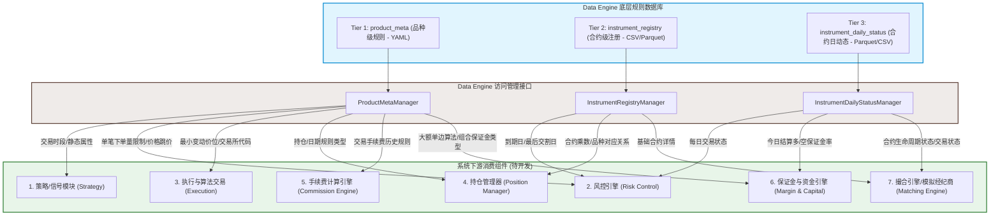

# 期货交易系统三层规则数据库与下游组件的通信关系分析

在期货量化交易系统中，底层规则数据库（元数据）是维持整个系统正常运转的“法律准绳”。根据系统设计，交易规则分为三层（`product_meta`、`instrument_registry`、`instrument_daily_status`）。本报告将系统性梳理这三层数据库与下游核心消费组件之间的通信关系。

---

## 1. 架构通信关系图

下图展示了底层三层数据库、数据引擎访问接口（Manager）以及下游各消费组件之间的通信脉络：

---

## 2. 下游消费组件及元数据需求

### 1) 策略/信号模块 (Strategy / Signal Module)
* **定位**：负责接收行情数据、运行计算因子、生成买卖信号。
* **通信需求**：
  * **Tier 1 (product_meta)**：需要查询 `sessions_history`。策略模块必须知道各个品种的交易时段（包括日盘、夜盘及其细分的小节时间），以避免在非交易时间段内发送信号，或在临近收盘时执行平仓逻辑（如日内CTA策略）。

### 2) 前置/后置风控引擎 (Pre- & Post-Trade Risk Control Engine)
* **定位**：负责在委托申报前进行合规拦截，在盘中进行实时监测，避免违规交易和穿仓风险。
* **通信需求**：
  * **Tier 1 (product_meta)**：
    * `price_tick_history`（最小变动价位）：校验报单价格是否是 `price_tick` 的整数倍。
    * `order_volume_limits_history`（下单量限制）：拦截超出单笔最大/最小限制的委托包（如股指限价单限 200 手）。
  * **Tier 2 (instrument_registry)**：
    * `expire_date` / `start_deliv_date`：执行 **“交割月风控规则”**。国内商品期货通常禁止 Speculator（投机户/个人/无现货接货能力的机构）持仓进入交割月（或进入交割月前一个月的下旬）。风控引擎必须提前查询这些日期，在阈值天数前发出强平或换月指令。
  * **Tier 3 (instrument_daily_status)**：
    * `is_trading` / `inst_life_phase`：校验该合约当前是否正常处于交易状态，暂停交易或到期退市的合约直接拦截。

### 3) 执行与算法交易引擎 (Order Execution & Algorithmic Trading)
* **定位**：负责将策略的“目标仓位”转化为具体的限价单/市价单，或运行 TWAP、VWAP、冰山等拆单算法。
* **通信需求**：
  * **Tier 1 (product_meta)**：
    * `price_tick_history`（最小变动价位）：在生成买一/卖一超价单或挂单时，利用 `price_tick` 对报单价格做规整（Round to Tick）。
    * `order_volume_limits_history`：在拆单时，单笔委托量不能超过 `max_limit_order_volume`。

### 4) 持仓管理器 (Position Manager)
* **定位**：实时记录和维护策略的虚拟持仓以及柜台的真实持仓（多头、空头、昨仓、今仓）。
* **通信需求**：
  * **Tier 1 (product_meta)**：
    * `position_date_type`（持仓日期类型）：非常关键。上海期货交易所（SHFE）和能源中心（INE）严格区分“今仓”和“昨仓”，平仓时必须分别指定 `CloseToday` 或 `Close`；而大商所（DCE）、郑商所（CZCE）和中金所（CFFEX）则不区分。持仓管理器在构建平仓委托时，必须根据该字段判断是否需要做今昨仓分拆报单。
    * `multiplier_history`（合约乘数）：计算总持仓价值（合约面值 = 价格 × 持仓量 × 合约乘数）。
  * **Tier 2 (instrument_registry)**：
    * `multiplier`：直接获取特定具体合约的乘数（应对少部分品种历史新老划断导致同一品种不同年份乘数不同的情况）。

### 5) 手续费计算引擎 (Commission & Transaction Cost Engine)
* **定位**：在回测或盘后结算中，精确计算每一笔交易产生的手续费及总成本。
* **通信需求**：
  * **Tier 1 (product_meta)**：
    * `transaction_cost_history`（交易成本历史）：获取对应交易日期下，对应品种的开仓、平昨、平今手续费（支持按固定金额 `flat` 或按成交额比例 `ratio` 收取）。
    * `multiplier_history`（合约乘数）：如果是按手收取，需要乘数和价格来计算比例费率下的金额。

### 6) 保证金与资金引擎 (Margin & Capital Engine)
* **定位**：计算实时持仓保证金占用、可用资金、评估风险度，在模拟回测中模拟强平逻辑。
* **通信需求**：
  * **Tier 1 (product_meta)**：
    * `max_margin_side_algorithm`（大额单边算法）：中国期货市场广泛使用大额单边规则。若同一个品种策略同时持有多仓 100 手、空仓 80 手，保证金只按 100 手收取。保证金引擎需以此判断是否进行多空对冲计算。
    * `combination_type`（组合保证金类型）：是否支持大商所、郑商所的套利组合或中金所的 SPBM 组合保证金减免。
  * **Tier 3 (instrument_daily_status)**：
    * `long_margin_ratio` / `short_margin_ratio`：实时多空保证金率。注意：**保证金率是高度动态变化的**（节假日、异常波动、临近交割月时交易所均会大幅上调）。必须每日读取 Tier 3 动态数据进行实时评估。

### 7) 撮合引擎/模拟经纪商 (Matching Engine / Broker Simulator)
* **定位**：在回测环境中，模拟交易所的队列和成交规则，对策略发送的委托进行撮合。
* **通信需求**：
  * **Tier 2 (instrument_registry)** / **Tier 3 (instrument_daily_status)**：
    * `is_trading` / `inst_life_phase`：如果合约已暂停交易（`is_trading == 0`）或已退市（`inst_life_phase == 3`），对策略订单做拒单处理。

---

## 3. 字段级通信矩阵 (Communication Matrix)

下表总结了下游各组件对底层交易规则数据库的依赖路径、字段和查询频次：

| 下游消费组件 | 依赖的规则库级别 | 核心查询字段 | 查询频次 (Backtest vs. Live) | 典型应用场景 |
| :--- | :--- | :--- | :--- | :--- |
| **策略/信号模块** | Tier 1 (product_meta) | `sessions_history` | **初始化 / 每日一次** | 过滤非交易时间的脏信号，或临近尾盘时的平仓处理 |
| **预前风控引擎** | Tier 1 (product_meta) Tier 2 (instrument_registry) Tier 3 (instrument_daily_status) | `price_tick_history`, `order_volume_limits_history` `expire_date`, `start_deliv_date` `is_trading`, `inst_life_phase` | **逐笔报单时查询 (超高频)** | 价格跳价整除校验、超单量拒单；临近交割月自动警报/强平拦截 |
| **执行与算法交易** | Tier 1 (product_meta) | `price_tick_history`, `order_volume_limits_history` | **逐笔报单时查询 (超高频)** | 对报单价格做 Round-to-Tick 规整；大单分拆成多个小单申报 |
| **持仓管理器** | Tier 1 (product_meta) Tier 2 (instrument_registry) | `position_date_type`, `multiplier_history` `multiplier` | **报单及成交回报时 (高频)** | 上期所/能源中心平今仓、平昨仓指令分拆；持仓市值动态更新 |
| **手续费计算引擎** | Tier 1 (product_meta) | `transaction_cost_history`, `multiplier_history` | **逐笔成交回报时 (中频)** | 回测成本扣减；每日盘后账单 PnL 精确核对 |
| **保证金与资金** | Tier 1 (product_meta) Tier 3 (instrument_daily_status) | `max_margin_side_algorithm`, `combination_type` `long_margin_ratio`, `short_margin_ratio` | **盘中实时 / 每日盘后结算** | 动态计算多空对锁单边保证金占用；假期前/临近交割保证金暴涨预警 |
| **撮合引擎** | Tier 2 / Tier 3 | `inst_life_phase`, `is_trading` | **逐笔撮合时 (高频)** | 遇到退市或停牌合约，模拟拒单 |

---

## 4. 架构设计与通信规范建议

为了保证你的量化交易系统在高性能、易维护、易拓展上达到工业级水平，建议在设计下游组件时遵循以下原则：

1. **禁止下游组件直接穿透读取数据库物理文件 (No Direct File Access)**
   * 下游组件（风控、持仓等）**绝对不能**直接去读取 `product_meta` 的 YAML 或 `instrument_registry` 的 CSV/Parquet 文件。这会导致大量的重复文件 I/O 成为性能瓶颈，且一旦文件路径或格式微调，所有下游组件都要重写。
   * **标准做法**：数据引擎封装并暴露 `ProductMetaManager`、`InstrumentRegistryManager`、`InstrumentDailyStatusManager`。下游组件通过这些 API 间接获取结构化的数据对象（如 `StaticMeta`、`MarginRule` 等）。

2. **多级缓存策略加速查询 (Caching Strategy)**
   * 在实盘或高频回测中，风控引擎和执行引擎需要在微秒级完成价格规整和下单量拦截。
   * **标准做法**：`ProductMetaManager` 和 `InstrumentRegistryManager` 在系统启动（或者每日开盘前）将所有静态配置与历史记录懒加载进内存（使用 `dict` 缓存），盘中所有的查询都应该是内存中的 **O(1)** 字典查找。

3. **严格防止“未来函数” (Avoid Lookahead Bias)**
   * 在回测状态下，手续费引擎、风控引擎查询 `effective_date` 相关的历史规则时，**必须传入回测当前的模拟交易日期（`trading_date`）**。
   * **标准做法**：设计 Manager 接口时，所有涉及版本化历史的方法（如 `get_transaction_cost(product, trading_date)`）必须强制传入 `trading_date`。如果不传或者默认使用最新规则，回测就会使用未来的手续费或保证金规则，导致回测失真。

4. **联合校验接口封装 (Unified Rule Query)**
   * 某些业务规则需要跨层校验。例如“当前交易日的交易时段”不仅取决于 `product_meta` 中的常规时间段，还取决于 `instrument_registry` 中的到期日（最后交易日收盘提前）以及合约生命周期。
   * **标准做法**：在数据引擎（Data Engine）层统一封装高阶查询服务，而不是让下游风控引擎自己去拼装三个数据库的规则。
