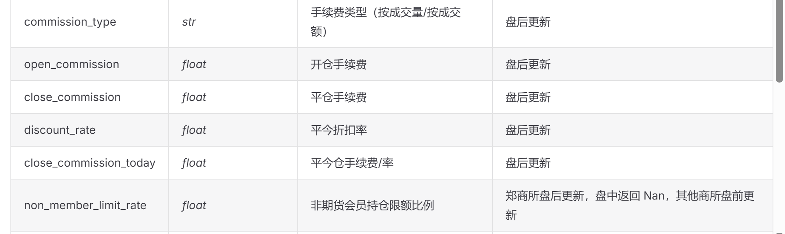

本轮修改的任务，是获取数据引擎所需的数据。
这一轮任务，我将大范围试用和评估当下流行的2-3个 AI agent。即 Antigravity, Claude Code, CodeX。

一、`FileLocator` 的重构
说明：将 FileLocator 修改为符合本地数据（1min、TICK）存储方式。见 file_locator.py 的 TODO。

先用1-2天时间。仔细梳理一遍目前所需的数据，数据格式和结构以及相应的储存位置。

## 数据需求列表：
1. 品种元数据

储存位置：
data/
└── metadata
    └── instrument_meta/
        ├── RB.yaml     # 螺纹钢
        ├── CU.yaml     # 铜
        ├── AL.yaml     # 铝
        ├── IF.yaml     # 沪深300股指
        └── ...

说明：一个品种一个yaml文件。静态属性直接存，历史变化的字段用 effective_date 版本化管理。

例：见 './data/metadata/instrument_meta/test.yaml'。

所需数据（包括但不限于以下）：

* 静态属性： 品种代码(product), 交易所(exchange), 合约乘数(contract_multiplier), 最小变动价位(tick_size)。
* 交易成本规则：生效日期(effective_data), 交易手续费比例(commission_rate), 每手交易手续费(commission_per_lot), 平今仓折扣率(intraday_offset_discount_rate)。
* 保证金规则：生效日期(effective_date), 交易所保证金率(exchange_margin_rate), 券商保证金率(broker_margin_rate)。
* 交易时段规则：生效日期(effective_date), 日盘时段(day_sessions), 夜盘时段(night_sessions)。

2. 日频快照

储存位置
data/
└── storage
    └── daily_snapshots/
        ├── RB_daily.parquet
        ├── CU_daily.parquet
        ├── IF_daily.parquet
        └── ...

说明：一个品种一个parquet文件。包含但不限于下面的列： TradingDate, Contract, OpenInterest, Close, UpperLimitPrice, LowerLimitPrice。

3. 交易日历

储存位置
data/
    └── calendar
        └── trading_calendars
            ├── SHFE.csv    # 上期所
            ├── DCE.csv     # 大商所
            ├── CZCE.csv    # 郑商所
            ├── CFFEX.csv   # 中金所
            ├── INE.csv     # 上海国际能源中心
            ├── GFEX.csv    # 广州期货交易所

说明：每个CSV 文件只有一列 trading_date 。


## BigQuant 期货数据库

* 据 BigQuant：品种代码区分大小写，比如郑商所的品种代码全为大写（白糖-SR，棉花-CF）；大商所的品种代码全为小写（豆粕-b，生猪-lh）。【是否有必要对代码逻辑 or 本地数据进行修改？】
* 据 BigQaunt: 对换月逻辑，待切换的主力合约需要是当前主力合约的远期合约，即交割月份大于当前主力合约。这一条我目前的代码逻辑中没有，是否需要补全？


### 期货品种信息表(cn_future_product_info)
* 对于我所需要的所谓元数据（metadata），BigQuant存在一个叫做“期货品种信息(cn_future_product_info)”的表里。见[cn_future_product_info](https://bigquant.com/data/datasources/cn_future_product_info)

### 期货基本信息表(cn_future_basic_info)

* 对于元数据，BigQuant采用了每个合约都有“元数据”的方案，每个合约的“元数据”字段包括：合约代码、上市日期、退市日期、最后交割日、合约乘数、最小变动价位等。这里超出了原先我设想的范围，原先我设想的仅仅是品种层面有“元数据”，合约层面没有这个内容。见[cn_future_basic_info](https://bigquant.com/data/datasources/cn_future_basic_info)。

### 期货静态信息表(cn_future_static_data)

* BigQuant记录了合约-交易日层面的“静态属性”。见[cn_future_static_data](https://bigquant.com/data/datasources/cn_future_static_data)。


* 对于所需的日频快照数据(Daily Snapshot)，BigQuant将其记录在日频行情中(cn_future_bar1d)。包括了我所需要的涨跌停价，OHLC，结算价和持仓量。见[cn_future_bar1d](https://bigquant.com/data/datasources/cn_future_bar1d)。


## 关于同一合约因生命周期阶段发生的交易时段变化：

* 这似乎说明交易时段不仅应该有生效日期这个字段，还应该有某种适用规则。
中国期货市场主要有两类因合约生命周期导致的交易时段变化（缩短）：
1. 最后交易日收盘提前：国债期货（CFFEX）平时到15:15，最后交易日到11:30。股指期货（CFFEX, 2016年前），平时到15:15，最后交易日到15:00。
    * 《中国金融期货交易所交易细则》，第十二条：股指期货的交易时间为交易日9：15-11：30（第一节）和13：00-15：15（第二节），最后交易日交易时间为9：15-11：30（第一节）和13：00-15：00（第二节）。见[中国金融期货交易所交易细则](https://www.shanghaiinvest.com/cn/viewfile.php?id=4213)
2. 交割月临近无夜盘：商品期货（上期所、大商所、郑商所）当合约进入交割月（或交割月前一个月，依品种而定），为了防止交割风险，夜盘强制暂停，仅保留日盘。

因此，如果系统在未来某个时候，需要获取“特定交易日的交易时段”，则需要加入一个联合校验逻辑：首先从 `product_meta` 数据库获取当前交易日已生效的“常规交易时段规则”；然后从合约注册表 `instrument_registry` 获取该合约的最后交易日、交割月份；如果当前交易日是最后交易日，则使用特殊的（提前收盘的）交易时段，同时如果是当前交易日属于临近交割月份，则使用特殊的（无夜盘）的交易时段。

## 本地期货信息数据库架构设计

按照 Gemini 的建议，采用如下三层架构。

### 第一层，品种规则配置（product_meta）

储存粒度：品种维度。
储存方式：本地 YAML 文件。

1. 静态属性：`product`(品种), `exchange`(交易所),  `position_type`(持仓类型), `position_date_type`(持仓日期类型), `max_margin_side_algorithm`(是否使用大额单边保证金算法), `combination_type`(组合类型)。
2. 版本化管理(带 `effective_date` )属性：

* `transaction_cost_history`(交易成本历史)：
    * `effective_date`
    * `commission_type`(手续费率类型, `flat` or `ratio`)
    * `open`(开仓)
    * `close_yesterday`(平昨)
    * `close_today`(平今)

* `price_tick_history`(最小变动价位)[^1]：
    * `effective_date`
    * `price_tick`
    * `remain_old_rule_inst`[^remain_old_rule_inst]

* `sessions_history`（交易时段历史）[^2]：
    * `effective_date`
    * `day_sessions`
    * `night_sessions`

* `multiplier_history`(合约乘数历史)[^3]：
    * `effective_date`
    * `multiplier`

* `order_volume_limits_history`（最大最小下单量限制历史）
    * `effective_date`
    * `max_market_order_volume`(市价单最大下单量)
    * `min_market_order_volume`(市价单最小下单量)
    * `max_limit_order_volume`(限价单最大下单量)
    * `min_limit_order_volume`(限价单最小下单量)

[^1]: 历史上曾出现过改变品种的最小变动价位，例如2020年大商所铁矿石期货变档，2020年上期所黄金变档。但需要注意的是，上面两个例子中，变档采用不同方式。铁矿石期货变档，采用了新老划断：2020年6月15日起，铁矿石 `I2009` 及以后得后续合约最小变动价位调整为1.0元/吨，而 `I2009` 以前的旧合约则保持0.5元/吨不变。而2020年上期所黄金变档，则采用了“一刀切”的方式：自2020年3月2日起，所有的黄金期货合约最小变动价位统一从0.05元/克调整为0.02。这意味着：`price_tick` 字段需要版本化管理；但对于某些品种，如果存在新老划断方式，我们在获取这个字段时，不能仅根据日期来获取，同时还要添加一个过滤条件，即在特定交易日期以后，该品种的某些老合约（例如 `I2007`，`I2008` 应该仍然采用旧的档位）。
[^remain_old_rule_inst]: 这个字段用于控制当某些情况下，交易所规定从特定日期开始生效新的最小价格变动档位规则，但采用新老划断的方式，这个字段下用于记录那些仍采用旧规则的“老”合约列表。

[^2]: 必须引入生效日期字段，中国期货交易所历史上多次改变过交易时段规则，例如初次引入夜盘（上期所在2013年7月5日在黄金和白银上引入）；夜盘时间多次微调；疫情时间关停（2020年2月3日起暂停，5月6日恢复）；股指期货交易时间调整；国债期货交易时间调整。所以，我们不能用当前的最新规则快照，必须引入生效日期。

[^3]: 说明：某些品种历史上曾改变过合约乘数，例如郑商所在2014年自郑醇1506合约开始，从50吨/手改为10吨/手，同时交易代码也由ME改为MA。同时采用新老划断方案——旧合约继续按照旧乘数交易直至交割退市，新上市的合约则启用新乘数。因此同一时间，可能存在某品种的不同合约的合约乘数不同。上述内容说明了两点：
    1. 在品种规则层，`multiplier` 需要采用历史版本管理。
    2. 在合约注册层，每个合约都要有一个固定的`contract_multiplier`。
    * 这和 `price_tick` 的处理方式还有差异，因为期货合约每手对应的实物商品数量在生命周期内是不可能中途更改的，所以对于合约乘数而言，对于每个期货合约注册一个固定的 `contract_multiplier` 是合理的。

### 第二层，合约注册层（instrument_registry）。

储存粒度： 每个交易所一个文件。
储存格式：本地 csv 文件或 parquet 文件。

这一层记录各合约的注册属性——一次写入，终身不变。包括以下字段[^4]：

* `instrument`(合约代码)
* `name`(合约名称)
* `product`(品种代码)
* `exchange`(交易所)
* `list_date`(上市日期)
* `delivery_year`(交割年份)
* `delivery_month`(交割月份)
* `start_deliv_date`(开始交割日)
* `end_deliv_date`(最后交割日)
* `expire_date`(合约到期日)
* `exchange_inst`(交易所报单代码)
* `multiplier`(合约乘数)

[^4]: 这里我们没有将 `price_tick` 包括进来（如 BigQuant 的做法）。这是因为，最小价格变动档位，在合约的生命周期内可能会发生变化。典型例子是2020年上期所黄金变档，因此需要不同的处理方法，具体见上文。

### 第三层，日频动态状态层（instrument_daily_status）。

储存粒度：合约-交易日。
储存格式：本地 parquet 或 csv。

字段：
* `trading_date`(交易日期)
* `instrument`(合约代码)
* `inst_life_phase`(合约生命周期状态)
* `is_trading`(当前交易状态)
* `long_margin_ratio`(多头保证金率)
* `short_margin_ratio`(空头保证金率)

说明：有些机构会把涨跌停价(`upper_price_limit`, `lower_price_limit`)放在这里。但我决定还是放日频快照数据库中(Daily Snapshot)。


```YAML
# data/metadata/instrument_meta/RB.yaml
# ... 静态属性保持不变 ...
# ── 交易成本历史 ──────────────────────────────
transaction_cost_history:
  - effective_date: "2015-01-01"
    commission_type: "flat"        # flat 表示按手收取定额费用
    open: 3.0                     # 开仓 3 元/手
    close_today: 3.0              # 平今 3 元/手
    close_yesterday: 3.0          # 平昨 3 元/手
  - effective_date: "2021-06-01"
    commission_type: "flat"
    open: 3.0
    close_today: 9.0              # 交易所调高平今手续费至 9 元/手（抑制日内投机）
    close_yesterday: 0.0          # 郑商所和大商所部分品种甚至实行过平昨免手续费（0元/手）

```

下面，我将逐个解释 BigQuant 期货数据库中的 static_data 的各个字段（对于这些字段，我将其归类到了我的数据库的不同层级），包括其含义和主要作用、系统组件的功能映射。

2. 市价单/限价单 最大/最小下单量 (Max/Min Order Volumes)： 单笔委托能发送的最大和最小手数。最小下单量各期货品种通常为1手（但也不一定，例如红枣曾调整过到4手），最大的则有不同。例如金融期货最大市价下单数为50手，限价单最大为200手。
影响组件：风控引擎
* 风控引擎：对于任何超出最大下单量的委托做拒单处理。

3. 价格档位（tick size）：最小变动价位。例如沪深300股指期货为0.2点指数点。
影响组件：风控引擎
* 风控引擎：委托价格必须是价格档位的整数倍。对于不符合的，应该将做规整或直接拒单。

4. 多头/空头保证金率(long/short margin rate)：期货合约的保证金是一个随时间变化的值。例如临近交割月、长假前、单边市时，交易所会提高保证金。
影响组件：资金与保证金引擎
资金与保证金引擎：需要实现动态计算保证金，同时考虑期货公司加收。同时还有冻结资金的计算，若冻结资金小于0，要模拟实盘中的强平操作。

5. 大额单边保证金算法(large margin single-side)：若策略同时持有某一期货的多头和空头，此时仅收取大额单边的保证金（例如多100手，空80手，只收取多100手的保证金）。中金所逐步推行的SPBM组合保证金系统，是指在跨品种、跨期组合之间，通过评估组合的净风险，来降低保证金占用。
影响组件：资金与保证金引擎
资金与保证金引擎：同4，考虑大额单边保证金算法对动态保证金计算的影响。

6. 组合类型（combination type）：期货组合有对锁、跨期组合和跨品种组合。当满足组合类型条件时，保证金收取有优惠。不同交易所的规定不同，有时区分盘中优惠和结算后优惠。
* 对锁：在同一期货品种同一月份合约上建立数量相等、方向相反的头寸。此时一般采用高腿保证金，也叫大额单边保证金。
* 跨期：在同一期货品种的不同月份合约上建立数量相等、方向相反的头寸。一般也是大额单边。同时，不同交易所具体规定不同。
* 跨品种：在不同期货品种合约上建立数量相等、方向相反的头寸。大额单边保证金。不同交易所具体规定不同，例如郑商所规定跨品种只适用于规定的几对品种。
影响组件：资金与保证金引擎。

见如下两个参考链接：
(1) [深入了解期货与期权的组合保证金制度，做资金管理的朋友](https://zhuanlan.zhihu.com/p/467748794)
(2)[组合保证金优惠规则](https://www.htqhedu.com/col115/79)

6. 持仓类型（position type）：净持仓和双向持仓，国内都为双向持仓。持仓日期类型（position date type）：今仓或昨仓。
影响组件：持仓引擎、手续费引擎
手续费引擎：今仓和昨仓的手续费可能不同。需要区别对待。

7. 合约生命周期类字段
合约到期日、开始交割日、最后交割日
影响组件：风控引擎
风控引擎：禁止无现货处理能力的机构（例如私募基金）持仓进入交割月。所以风控引擎必须在临近交割日/开始交割日前，提醒换月或强制平仓。

合约生命周期状态，当前交易状态
影响组件：撮合引擎
撮合引擎：在退市或暂停交易状态下，撮合引擎拒单处理。

---


在 CTP API（上期技术期货交易接口）中，`CThostFtdcInstrumentField` 是通过查询合约接口（`ReqQryInstrument`）返回的**最核心的合约属性结构体**。

BigQuant 的 `cn_future_static_data`（期货静态信息表）字段，实际上**就是 CTP 中这个 C++ 结构体字段的 1:1 直接映射和落库**。这也是许多量化平台直接从柜台系统（如 CTP 或 SimNow）拉取合约元数据的标准做法。

以下是 `CThostFtdcInstrumentField` 的完整字段、数据类型、中文名称以及取值说明的对照表：

| 序号 | CTP 属性名 (Field Name) | 数据类型 (Type) | 中文名称 (Chinese Name) | 详细说明与取值 (Description & Enums) |
| :--- | :--- | :--- | :--- | :--- |
| 1 | **InstrumentID** | `char[31]` | 合约代码 | 例如 `rb2610`, `IF2606`。实盘报单的唯一标识。 |
| 2 | **ExchangeID** | `char[9]` | 交易所代码 | `SHFE` (上期所), `DCE` (大商所), `CZCE` (郑商所), `CFFEX` (中金所), `GFEX` (广期所) 等。 |
| 3 | **InstrumentName** | `char[81]` | 合约名称 | 例如 “螺纹钢2610” 或 “沪深300指数2606”。 |
| 4 | **ExchangeInstID** | `char[31]` | 合约在交易所的代码 | 通常与 `InstrumentID` 相同，部分内盘或外盘系统中有细微差异。 |
| 5 | **ProductID** | `char[31]` | 产品代码 (品种代码) | 例如 `rb`, `IF`, `sr`。对应品种级元数据。 |
| 6 | **ProductClass** | `char` | 产品类型 | `1`: 期货 (Futures), `2`: 期权 (Options), `3`: 组合 (Combination) 等。 |
| 7 | **DeliveryYear** | `int` | 交割年份 | 例如 `2026`。 |
| 8 | **DeliveryMonth** | `int` | 交割月份 | 例如 `10`。 |
| 9 | **MaxMarketOrderVolume** | `int` | 市价单最大下单量 | 单笔市价单允许的最大手数。 |
| 10 | **MinMarketOrderVolume** | `int` | 市价单最小下单量 | 通常为 `1`。 |
| 11 | **MaxLimitOrderVolume** | `int` | 限价单最大下单量 | 单笔限价单允许的最大手数（如股指为 `200`）。 |
| 12 | **MinLimitOrderVolume** | `int` | 限价单最小下单量 | 通常为 `1`。 |
| 13 | **VolumeMultiplier** | `int` | 合约数量乘数 (合约乘数) | 一手合约所代表的标的物数量（如螺纹钢为 `10` 吨/手）。 |
| 14 | **PriceTick** | `double` | 最小变动价位 | 价格波动的最小步长（如螺纹钢为 `1.0`，股指为 `0.2`）。 |
| 15 | **CreateDate** | `char[9]` | 创建日期 | 格式为 `YYYYMMDD`，该合约在交易所系统创建的日期。 |
| 16 | **OpenDate** | `char[9]` | 上市日 (开始交易日) | 格式为 `YYYYMMDD`，合约开始挂牌交易的日期。 |
| 17 | **ExpireDate** | `char[9]` | 到期日 | 格式为 `YYYYMMDD`，合约最后交易日。 |
| 18 | **StartDelivDate** | `char[9]` | 开始交割日 | 格式为 `YYYYMMDD`，商品期货开始交割物理商品的日期。 |
| 19 | **EndDelivDate** | `char[9]` | 最后交割日 | 格式为 `YYYYMMDD`，交割流程结束日期。 |
| 20 | **InstLifePhase** | `char` | 合约生命周期状态 | `0`: 未开始交易, `1`: 正在交易 (Started), `2`: 暂停 (Pause), `3`: 到期退市 (Expired)。 |
| 21 | **IsTrading** | `int` (bool) | 当前是否在交易 | `1` 为在交易状态，`0` 为非交易状态。 |
| 22 | **PositionType** | `char` | 持仓类型 | `1`: 净持仓 (Net), `2`: 双向持仓 (Gross) （国内商品期货均为双向持仓）。 |
| 23 | **PositionDateType** | `char` | 持仓日期类型 | `1`: 使用昨仓与今仓概念（SHFE/INE 区分平今平昨）, `2`: 不区分（CZCE/DCE/CFFEX）。 |
| 24 | **LongMarginRatio** | `double` | 多头保证金率 | 合约当前的结算多头保证金率（交易所/期货公司设定）。 |
| 25 | **ShortMarginRatio** | `double` | 空头保证金率 | 合约当前的结算空头保证金率。 |
| 26 | **MaxMarginSideAlgorithm**| `char` | 是否使用大额单边算法 | `0`: 不使用, `1`: 使用（用于判定多空对冲只收单边保证金）。 |
| 27 | **UnderlyingInstrID** | `char[31]` | 基础商品代码 (标的合约) | 主要用于期权，指向其挂钩的标的期货合约代码（如 `ru2609`）。 |
| 28 | **StrikePrice** | `double` | 执行价 | 主要用于期权合约。如果为期货合约，该字段通常为 `0` 或空。 |
| 29 | **OptionsType** | `char` | 期权类型 | `1`: 看涨期权 (Call), `2`: 看跌期权 (Put)。期货合约不适用。 |
| 30 | **UnderlyingMultiple** | `double` | 标的证券乘数 | 期权对应的标的乘数。 |
| 31 | **CombinationType** | `char` | 组合类型 | 套利合约或组合持仓的匹配规则类型。 |


## TODOs

-[x] 统一三层数据库中的各字段的中文和英文名称。

-[x] 搞明白为什么合约会有`position_type`和`position_date_type`这两个字段。
    * `position_date_type`（持仓日期类型）是一个业务规则标识(rule flag)，用于区分该合约在交易所交易结算规则中，是否区分“今仓”和“昨仓”。若交易所区分两者（例如上期所、上海国际能源交易所），则系统在给交易所执行和下单时，需要（先查询持仓管理器,position manager）填报平今仓多少手，平昨仓多少手；如果不区分，则直接报平仓即可，交易所会按照先开先平的原则自动处理。
    * 这个字段在数据库的哪一个层级？Gemini 的建议是放第一层(product_meta)，理由有几点：第一，合约是否区分今仓昨仓，是由交易所作为一个整体决定的——上期所和上海国际能源交易所的所有品种都区分，而其他交易所的所有品种都不区分。第二，实盘交易中，收到策略信号->向交易所报单需要尽可能快（微妙级别），而由于报单字段需按需包含`position_date_type`字段，因此查询速度越快越好，若放在 tier3 ，则查询速度会很慢，tier1 则快的多。

-[x] 进一步确定三层数据库中，各字段的最佳位置（归属于tier1/2/3）。尽量满足系统设计的最佳实践：SSOT(single source of truth)，同时充分考虑字段查询速度（这一条关注哪些字段可以从 tier3 挪到 tier1/2）。

-[x] 确定三层数据库分别的本地存放路径，相应的文件组织格式，命名标准。相应的本地的模块/文件组织格式需要的修改。

    -[x] 修改 product_meta_manager.py 中的类名称(`InstrumentMetaManager`)。同时修改其他地方的引用，包括导入。

- [x] 厘清 Data Engine 模块底层的三层期货交易规则数据库(product_meta, instrument_registry, instrument_daily_status)和下游组件（消费方）的通信关系：下游有哪些主要组价，这些组件分别有和哪个或哪几个数据库通信的需求。必要时画图说明。
    * 结果见 ./docs/tak with AI/期货交易系统三层规则数据库与下游组件的通信关心分析.md。

-[x] 根据目前已厘清的期货交易规则三层数据库，修改相应的`metadata`模块的代码。包括product_meta_manager.py, instrument_registry_manager.py以及instrument_daily_status_manager.py。利用已厘清的三层数据库和下游消费组件之间的通信关系，编写相应代码。
    * product_meta_manager.py: 目前已经基本修改好。仍待完善的点：
        1.  目前有根据品种名称合成路径并读取的操作。例如第172行。但我本地的品种元数据的命名方式之前规定成了{EXCHANGE}_{PRODUCT}.yaml。到底前面需不需要加交易所代码，这里需要做一个对齐。
    
    -[x] 完成 instrument_registry_manager.py

    -[x] 完成 instrument_daily_status_manager.py

-[] 从 BigQuant 下载数据到本地，并根据已设定好的期货交易规则三层数据库进行导入和规整。这一步比较繁琐，在 BigQuant 充值好和把API弄懂以后，尝试让AI Agent来做（御三家都尝试一下）。

-[x] 在product_meta_manager.py中，我将原本的 `symbol_root` 做了变量名修改——修改为了 `product`。接下去需要在整个数据引擎模块，对所有相应变量名进行同样的修改。
-[] 合约代码这个概念，到底是用 instrument 好，还是维持之前的 contract。哪个命名更好？是否需要做统一？例如我现在的tier2数据库命名是InstrumentRegistry，而之前的代码对合约的命名都是 contract。

## 数据采集

BiqQuant -> 本地数据库

需要收集的数据库有两个：1. TIER 1-3 期货交易规则数据库； 2. 日频快照数据库。

### TIER1 -3 期货交易规则数据库

下面我将用3个表格，分别列出 TIER1 -3 的本地期货交易规则数据库中的字段，以及相对应的 BigQuant 数据库对应字段，相关说明见每一行的Notes。

这里有一个关于平今折扣率变量。似乎我没有记录。


见[米筐量化](https://www.ricequant.com/doc/rqdata/python/futures-mod#rqdata-API-futures-get_trading_parameters)

过一遍米筐量化的期货数据库，看看是否还有哪些字段遗漏？

260608任务：先让AI帮我看看三层期货交易规则数据库是否完善，字段的归属以及三层分类是否合理。这可能需要做几次简单的调整。
如果上面的完成了。那么让AI根据我的三层数据库，给我一个历史数据采集方案。是从量化研究平台（例如 BigQuant, RiceQuant等平台下载——这里存在字段无法一一对应的问题，有些字段在我这里是TIER1,但在他们的数据库里对应TIER3）。


